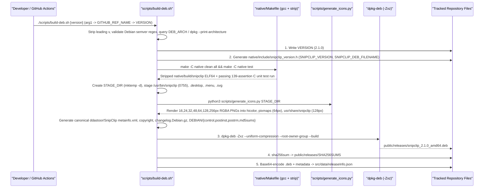

# SnipClip — Exhaustive "As-Is" System Specification (`v2.1.0`)

> **Document Scope & Ground-Truth Guarantee**: This specification documents the exact, verified **as-is** implementation of the `ddastoor/SnipClip` repository (`main`, version `2.1.0`, following completion of roadmap tasks `P0-1` through `P2-10`). Every file path, C struct, GTK widget hierarchy, TypeScript interface, CLI flag, GDBus call, Debian packaging rule, environment variable, and test assertion below has been verified directly against source files and live execution.

---

## 1. Project Overview & Core Purpose

**SnipClip** brings the **Microsoft Windows 11 Snipping Tool** workflow to Debian-based Linux distributions (**Debian 12 Bookworm**, **Debian 13 Trixie**, **Ubuntu 22.04 / 24.04 / 24.10 / 25.04**, **Kubuntu**, **Linux Mint 21/22**, **Pop!\_OS**, **Kali Linux**, **Zorin OS**, and **MX Linux**) with zero command-line configuration required for end users.

The repository implements a **dual-surface architecture** synchronized to a single semantic version (`VERSION` = `2.1.0`):

1. **Native Compiled Linux Desktop Application (`native/`, `packaging/`, `scripts/`)**:
   - Produces a stripped 64-bit C11 ELF executable (`/usr/bin/snipclip`, `129,240` bytes, compiled from 8 C11 modules in `native/src/*.c` with GTK 3, Cairo, GdkPixbuf, GIO/GDBus, and `libX11`) packaged inside an `xz`-compressed Debian binary archive (`snipclip_2.1.0_amd64.deb`, `59,992` bytes).
   - **Zero interpreted runtime dependencies**: `/usr/bin/snipclip` contains no Python, Node.js, or Electron runtime; `python3` is used only at build time (`scripts/generate_icons.py`) and in the integration test suite (`linux/tests/test_native_elf_and_deb.py`).
   - **Automatic GUI Startup Display Detection & 1:1 Capture Plan**: Prior to calling `gtk_init_check()`, the binary executes a 7-tier cascade across `XDG_SESSION_TYPE`, `WAYLAND_DISPLAY`, `DISPLAY`, `loginctl`, `$XDG_RUNTIME_DIR/wayland-*` (or `/run/user/<uid>/wayland-*`), and `/tmp/.X11-unix/X*` sockets, bootstraps `GDK_BACKEND` / `WAYLAND_DISPLAY` / `XDG_RUNTIME_DIR` / `DISPLAY`, reconciles against the live `GdkDisplay` runtime type (`GdkWaylandDisplay` vs `GdkX11Display`), and executes `sc_wayland_capture_plan()` matching the reported `capture_driver` 1:1.
   - **Windows 11 Snipping Tool UX, Persistence, HiDPI & Global Hotkeys**: Opens in a compact **`460×200` px** launcher window (or starts hidden via `--background`); persists user preferences (`snip_mode`, `delay_seconds`, `custom_shortcut`) atomically in `$XDG_CONFIG_HOME/snipclip/config.ini`; registers system-wide `PrintScreen` + custom capture hotkeys via X11 `XGrabKey` and async Wayland `org.freedesktop.portal.GlobalShortcuts`; supports **4 snip modes** (`Rectangle`, `Window`, `Fullscreen`, `Freeform` lasso) with HiDPI logical-to-physical coordinate scaling (`sc_scale_rect_to_pixbuf`) and multi-monitor fullscreen (`GDK_FULLSCREEN_ON_ALL_MONITORS`), **4 delay timers** (`0s`, `3s`, `5s`, `10s`), **10 canvas tools** (`Pen`, `Highlighter`, `Eraser`, `Rect`, `Ellipse`, `Line`, `Arrow`, `Redact`, `Pixelate`/`Blur`, `Crop`), a draggable/rotatable **graduated Ruler** (`0°–180°` display with straight-edge stroke snapping), **Zoom** (`25%–400%`), **40-step Undo/Redo**, dual-layer **Clipboard persistence** (`GtkClipboard` + `wl-copy` or `xclip`), and **PNG/JPEG file export**.

2. **Interactive React 19 + TypeScript Web Workbench (`src/`, `tests/`, `index.html`, `public/`)**:
   - A client-side Vite 6 Single-Page Application (SPA) styled with Tailwind CSS v4 that runs completely in the browser with **zero backend server**.
   - Provides three interactive sections verified by an automated 18-test Vitest + React Testing Library suite (`tests/web-workbench.test.tsx`):
     1. **Snipping Studio (`src/components/SnipStudio.tsx`)**: A live HTML5 `<canvas>` simulation of the `460×200` launcher, simulated `1120×620` Debian 12 desktop (`src/utils/desktopScene.ts`), fullscreen capture overlay, all 4 snip modes, delay countdowns, all 10 annotation tools + ruler (including wheel `±5°` rotation) + crop + `25%–400%` zoom (`Ctrl+Wheel` + toolbar) + 30-step undo/redo, `localStorage`-backed `PrintScreen` / custom shortcut recorder, honest clipboard export feedback, and PNG/JPEG download toggle.
     2. **Display Detection Explorer (`src/components/DisplayDetectionPanel.tsx`)**: Interactive simulator for testing how session environment variables (`XDG_SESSION_TYPE`, `WAYLAND_DISPLAY`, `DISPLAY`, `XDG_CURRENT_DESKTOP`) and optional helper binaries (`xdg-desktop-portal`, `grim`, `wl-copy`, `xclip`, `spectacle`, `gnome-screenshot`) resolve SnipClip's startup capture and clipboard pipeline, coupled live to the Snipping Studio's simulated desktop.
     3. **Debian Package & GitHub Release Showcase (`src/components/DebReleaseSection.tsx`)**: Displays canonical `ddastoor/SnipClip` `src/data/releaseInfo.json` metadata, outbound links to [`github.com/ddastoor/SnipClip/releases`](https://github.com/ddastoor/SnipClip/releases), interactive GitHub tag-to-`.deb` version sync preview, inspectable `DEBIAN/control` / verbatim `?raw` `release-deb.yml` / 16-file `.deb` file tree tabs, and a magic-byte verified (`!<arch>\n` + `debian-binary`) `.deb` and `SHA256SUMS` downloader (`src/utils/debDownload.ts`) backed by embedded base64 (`debBase64`) with static `/releases/snipclip_2.1.0_amd64.deb` fallback.

---

## 2. Tech Stack, Versions & Runtime Requirements

### 2.1 Toolchain & Library Versions: Local / CI Host vs. Official Release Container

| Layer / Component | Local / Ubuntu 24.04-Base Host (Verified As-Is) | Official Release Container (`.github/workflows/release-deb.yml`) | Role in SnipClip |
| :--- | :--- | :--- | :--- |
| **Operating System** | Ubuntu `24.04` / Zorin OS (`amd64`) | `debian:bookworm` (Debian 12, `amd64`) | Build & test host OS |
| **C Compiler** | `gcc` `13.3.0` (`-std=c11 -O2 -Wall -Wextra -U_FORTIFY_SOURCE -D_FORTIFY_SOURCE=2`) | `gcc` `12.2.0` (Debian Bookworm `build-essential`) | Compiles `native/build/snipclip`, `test_snipclip_native`, and `test_editor_gtk` |
| **Build Automation** | GNU Make `4.3`, `pkg-config`, `binutils` (`strip`, `ar`, `objdump`) | GNU Make `4.3`, `pkg-config`, `binutils` | Native C compilation, symbol stripping, ELF/ar inspection |
| **GNU C Library (`libc6`)** | `GLIBC 2.39` (emits `GLIBC_2.38` symbol ceiling in local `.deb`) | `GLIBC 2.36` (enforces `<= GLIBC_2.36` ceiling for multi-distro `.deb` portability) | Standard C / POSIX runtime (`libc.so.6`, `libm.so.6`) |
| **GTK 3 (`gtk+-3.0`)** | `3.24.41` (`libgtk-3-dev` / `libgtk-3-0t64`) | `3.24.38` (`libgtk-3-dev` / `libgtk-3-0`) | Native windowing, widgets, CSS provider, clipboard, dialogs |
| **GLib / GIO / GDBus (`gio-2.0`)** | `2.80.0` (`libglib2.0-0t64`) | `2.74.6` (`libglib2.0-0`) | Main loop, process spawning, D-Bus Screenshot & GlobalShortcuts Portal clients |
| **Cairo (`cairo`)** | `1.18.0` (`libcairo2`) | `1.16.0` (`libcairo2`) | 2D vector rendering for overlay cutouts, ink strokes, shapes, ruler, mosaic |
| **GdkPixbuf (`gdk-pixbuf-2.0`)** | `2.42.10` | `2.42.10` | Raster pixel buffers, cropping, PNG/JPEG encoding/decoding |
| **X11 Client Library (`x11`)** | `1.8.7` (`libx11-dev` / `libx11-6`) | `1.8.4` (`libx11-dev` / `libx11-6`) | Direct `_NET_CLIENT_LIST_STACKING` window snapping & root `XGrabKey` hotkeys |
| **Debian Packager** | `dpkg-deb` `1.22.x` (forced `-Zxz --uniform-compression`) | `dpkg-deb` `1.21.22` (`-Zxz --uniform-compression`) | Builds `snipclip_2.1.0_amd64.deb` without Ubuntu's default `zstd` compression |
| **Headless X Server** | `Xvfb` + `xauth` | Installed in `.github/workflows/ci.yml` (`ubuntu-latest`) | Executes `make -C native test-gtk`, `--print-ui-metrics`, and X11 `XGrabKey` collision tests |
| **Python** | `Python 3.12` (stdlib only: `zlib`, `struct`, `unittest`, `ctypes`, `xml.etree`) | `Python 3.11.x` (Debian Bookworm `python3`) | Build-time PNG icon generator & 10-test ELF/`.deb` integration runner |
| **Node.js & npm** | Node.js `v22.x LTS`, `npm` | Node.js `22` (`actions/setup-node@v4` in `ci.yml`) | Web Workbench dev server, production bundle, `node:test`, and `vitest` UI runner |

> [!IMPORTANT]
> **ABI Portability Distinction (`GLIBC_2.38` vs `GLIBC_2.36`)**: Because `public/releases/snipclip_2.1.0_amd64.deb` currently committed in Git (`sha256: 87b2b61881d43014bc293e64d20b1a5fd43aad6836a507b9cd8b1bb424592eb4`, `59,992` bytes, built `2026-11-25T11:40:18Z`) was built on a `GLIBC 2.39` host with `-D_FORTIFY_SOURCE=2`, `objdump -T` shows its embedded `/usr/bin/snipclip` (`129,240` bytes) references `GLIBC_2.38`. Consequently, the in-repo `.deb` binary executes natively on Ubuntu 24.04+, Zorin OS, Mint 22, and Debian 13+, whereas official GitHub Release `.deb` assets built by `.github/workflows/release-deb.yml` inside `debian:bookworm` cap symbols at `<= GLIBC_2.36` so they also run on Debian 12 and Ubuntu 22.04.

### 2.2 Web Workbench `package.json` Dependencies

No lockfile (`package-lock.json`, `pnpm-lock.yaml`, or `yarn.lock`) is committed to the repository; CI installs via `npm install --no-package-lock --no-audit --no-fund` when `package-lock.json` is absent.

**Runtime `dependencies` (`package.json` lines 15–19)**:
- `react`: `^19.0.0` — UI component rendering (`StrictMode`, hooks).
- `react-dom`: `^19.0.0` — DOM root mounting (`createRoot`).
- `lucide-react`: `^0.511.0` — Crisp vector toolbar and action icons across `Header.tsx`, `DebReleaseSection.tsx`, and `SnipStudio.tsx`.

**Development `devDependencies` (`package.json` lines 20–34)**:
- `vite`: `^6.2.0` — Dev server (`port: 3000`) and Rollup-based static asset bundler (`dist/`).
- `@vitejs/plugin-react`: `^4.4.1` — React Fast Refresh / JSX transform plugin for Vite.
- `tailwindcss`: `^4.1.0` & `@tailwindcss/vite`: `^4.1.0` — CSS-first Tailwind v4 utility engine (`@import "tailwindcss";` in `src/index.css`).
- `typescript`: `~5.8.2` — Static typechecker (`tsc --noEmit` via `npm run lint`).
- `tsx`: `^4.19.0` — TypeScript execution wrapper used to run `node:test` (`npx --yes tsx --test src/utils/snipEngine.test.ts`).
- `vitest`: `^5.1.1`, `@testing-library/react`: `^16.3.3`, `@testing-library/dom`: `^10.4.2`, `jsdom`: `^31.0.1` — Headless React 19 DOM/UI test suite (`npm run test:ui`).
- `@types/node`: `^22.14.0`, `@types/react`: `^19.0.0`, `@types/react-dom`: `^19.0.0` — TypeScript ambient definitions.

### 2.3 Local Debian / Ubuntu `apt` Prerequisites

- **Build & Test Dependencies** (required to compile `native/`, build `.deb`, and run all 6 test stages):
  ```bash
  sudo apt-get update && sudo apt-get install -y \
    build-essential pkg-config libgtk-3-dev libx11-dev \
    dpkg-dev binutils python3 xvfb xauth
  ```
- **End-User `.deb` Runtime `Depends`** (`scripts/build-deb.sh` line 30):
  `libc6 (>= 2.35), libgtk-3-0t64 | libgtk-3-0, libglib2.0-0t64 | libglib2.0-0, libcairo2, libx11-6`
- **End-User `.deb` Runtime `Recommends`** (`scripts/build-deb.sh` line 31):
  `xdg-desktop-portal, xdg-desktop-portal-gtk | xdg-desktop-portal-kde | xdg-desktop-portal-gnome, wl-clipboard, xclip, grim, desktop-file-utils, shared-mime-info`

---

## 3. Annotated Repository Map

`scripts/build-deb.sh`, `scripts/generate_icons.py`, and `scripts/run-tests.sh` carry executable file mode **`100755`** in Git (`git ls-files --stage`), while all source, packaging, and documentation files carry `100644`.

```text
SnipClip/
├── .github/
│   └── workflows/
│       ├── ci.yml                          # Push/PR CI on ubuntu-latest: apt deps, Node 22, build-deb.sh, 6-stage run-tests.sh, npm run build
│       └── release-deb.yml                 # Release pipeline in debian:bookworm container: builds ABI-portable .deb + publishes GitHub Release
├── linux/
│   └── tests/
│       ├── __pycache__/                    # [GITIGNORED] Python bytecode cache from unittest runs
│       └── test_native_elf_and_deb.py      # 10-method Python unittest suite verifying ELF64, ldd/GLIBC, CLI, Xvfb 460x200 UI, xz .deb, t64 deps, canonical ddastoor/SnipClip metadata, and X11 XGrabKey collision handling
├── native/
│   ├── build/                              # [GITIGNORED] Compiled C artifacts: stripped `snipclip` ELF + `test_snipclip_native` + `test_editor_gtk`
│   ├── include/
│   │   ├── capture_backend.h               # Screen capture, Wayland interactive window portal, libX11 window enumeration (SC_MAX_WINDOWS=128), and clipboard daemon declarations
│   │   ├── config_store.h                  # Pure-C11/POSIX preference store ($XDG_CONFIG_HOME/snipclip/config.ini) for snip_mode, delay_seconds, custom_shortcut
│   │   ├── display_detect.h                # ScDisplayProtocol, ScDisplaySession, 7-tier detector, env bootstrap, GdkDisplay reconciler, 1:1 sc_wayland_capture_plan, JSON serializer, path normalizer
│   │   ├── editor_canvas.h                 # Opaque ScEditorCanvas widget API: tools, ink color/width, ruler, zoom, 40-step undo/redo (SC_MAX_HISTORY), crop, flattened pixbuf export
│   │   ├── geometry.h                      # Pure math types, sc_normalize_rect, sc_scale_rect_to_pixbuf (HiDPI), window-sizing constants (460x200), hit-testing & ruler snapping APIs
│   │   ├── global_hotkey.h                 # System-wide hotkey API (X11 XGrabKey + async Wayland org.freedesktop.portal.GlobalShortcuts)
│   │   ├── overlay.h                       # Fullscreen HiDPI-aware capture overlay API (sc_launch_capture_overlay) & completion/cancel/Wayland-window-recapture callbacks
│   │   └── snipclip_version.h              # Auto-generated C macros (SNIPCLIP_VERSION="2.1.0", SNIPCLIP_DEB_FILENAME, SNIPCLIP_RELEASE_TAG) synced by scripts/build-deb.sh
│   ├── src/
│   │   ├── capture_backend.c               # GDBus XDG Portal Screenshot client, sc_wayland_capture_plan executor, multi-monitor GDK root grab, libX11 stacking query, SIGPIPE-safe wl-copy/xclip pipe
│   │   ├── config_store.c                  # GTK/GLib-free INI parser & atomic writer (0700 parent dirs + 0600 temp file + fsync + rename)
│   │   ├── display_detect.c                # Environment/socket/loginctl cascade, GDK_BACKEND bootstrap, wlroots+grim capture plan, \u00XX-escaped JSON formatter, %f / file:// URI decoder
│   │   ├── editor_canvas.c                 # Cairo custom GtkDrawingArea annotation engine, alpha-preserving 10x10 pixelate mosaic, graduated ruler, crop overlay, 40-slot undo/redo stacks
│   │   ├── geometry.c                      # Pure C11 math implementation (clamped rect normalization, HiDPI rect scaling, polygon bbox/raycast, arrow wings, ruler fit/snap, window sizing)
│   │   ├── global_hotkey.c                 # Root XGrabKey across NumLock/CapsLock masks behind X11 error trap + async GDBus GlobalShortcuts session with ref-counted HkBox
│   │   ├── main.c                          # CLI parser (--background, etc.), config.ini load/save, GTK startup, CSS, 460x200 launcher & editor UI, shortcut recorder, GError file dialogs
│   │   └── overlay.c                       # Undecorated all-monitors fullscreen Cairo overlay, HiDPI logical->physical scaling, mode switcher pill, even-odd dim cutout, Wayland window recapture
│   ├── tests/
│   │   ├── test_editor_gtk.c               # Headless GTK 3 / Cairo canvas test binary (7 suites, 309 checks across all 10 tools, alpha pixelate, 40-step undo eviction, ruler snap, crop)
│   │   └── test_native.c                   # Headless pure-C11 unit test binary (7 suites, 139 assert() checks) linked with -lm only (zero GTK/X11 dependencies)
│   └── Makefile                            # Builds build/snipclip (stripped), build/test_snipclip_native (-lm), and build/test_editor_gtk (test-gtk target)
├── packaging/
│   ├── snipclip.desktop                    # Freedesktop launcher (`Exec=snipclip %f`) + 3 desktop context actions (RectSnip, WindowSnip, FullSnip)
│   ├── snipclip.menu                       # Legacy Debian Menu entry (`Applications/Graphics`, `/usr/bin/snipclip`)
│   └── snipclip.svg                        # Scalable 128x128 vector app icon (dark slate badge #0F172A, dashed cyan frame #38BDF8, white scissors #F8FAFC)
├── public/
│   └── releases/
│       ├── SHA256SUMS                      # Standard sha256sum manifest for snipclip_2.1.0_amd64.deb
│       └── snipclip_2.1.0_amd64.deb        # Built xz-compressed Debian binary package (59,992 bytes) served statically at /releases/snipclip_2.1.0_amd64.deb
├── scripts/
│   ├── build-deb.sh                        # [Mode 100755 in Git] Master release script: syncs VERSION + snipclip_version.h, compiles C, stages .deb, writes SHA256SUMS & releaseInfo.json
│   ├── generate_icons.py                   # [Mode 100755 in Git] Deterministic pure-Python 2x2-supersampled SDF rasterizer generating 16..256px hicolor/pixmap/app PNG icons
│   └── run-tests.sh                        # [Mode 100755 in Git] 6-stage unified test runner: C unit -> Xvfb GTK canvas -> Python ELF/.deb -> TS node:test -> Vitest UI -> tsc --noEmit
├── src/
│   ├── components/
│   │   ├── DebReleaseSection.tsx           # Web section #debian-package & #github-release: metrics, install commands, tag->version simulator, ?raw release-deb.yml & 16-file tree tabs, .deb download, GitHub Releases link
│   │   ├── DisplayDetectionPanel.tsx       # Web section #display-detection: 5 Linux desktop presets, live env/binary controls, resolved 7-row startup telemetry table
│   │   ├── Header.tsx                      # Sticky top navigation bar (#studio, #display-detection, #debian-package, #github-release), GitHub Releases link + primary Download .deb CTA
│   │   └── SnipStudio.tsx                  # Web section #studio: interactive 460x200 launcher, 1120x620 capture overlay, dynamic annotation editor (400% zoom, PNG/JPEG export), shortcut recorder
│   ├── data/
│   │   └── releaseInfo.json                # Auto-generated 14-key JSON artifact manifest including full base64-encoded .deb payload (`debBase64`, 79,992 chars)
│   ├── utils/
│   │   ├── debDownload.ts                  # Base64 decoder, Debian `!<arch>\n` + `debian-binary` magic-byte validator, and Blob download triggers
│   │   ├── desktopScene.ts                 # Procedural 1120x620 Debian 12 desktop wallpaper & 3 simulated application windows rendered to offscreen HTMLCanvasElement
│   │   ├── snipEngine.test.ts              # 18-test Node `node:test` suite testing TS geometry/detection/shortcuts + 5-way parity across VERSION, C header, ELF, and .deb
│   │   └── snipEngine.ts                   # Pure TypeScript domain engine (3 enums, 14 interfaces, 8 constants, 17 exported functions) mirroring native C logic
│   ├── App.tsx                             # Top-level React state coordinator linking session presets/custom env inputs across SnipStudio, DisplayDetectionPanel, DebReleaseSection, and footer links
│   ├── index.css                           # Tailwind CSS v4 import and custom `@theme` typography tokens (`Plus Jakarta Sans`, `JetBrains Mono`)
│   ├── main.tsx                            # Browser React 19 entry point mounting `<StrictMode><App /></StrictMode>` into `#root`
│   └── vite-env.d.ts                       # Vite client ambient types (`/// <reference types="vite/client" />`) enabling `?raw` asset imports
├── tests/
│   ├── setup.ts                            # Vitest jsdom setup: deterministic CanvasRenderingContext2D & pointer-capture polyfills + strict zero-console.error enforcement
│   └── web-workbench.test.tsx              # 18-test Vitest + React Testing Library UI suite covering all data-testid hooks, 400% zoom, ruler wheel, PNG/JPEG export, clipboard fallbacks, and .deb tabs
├── dist/                                   # [GITIGNORED] Vite production build output (`dist/index.html`, `dist/assets/*`, copied `public/*`)
├── node_modules/                           # [GITIGNORED] Installed npm packages
├── .env.example                            # Sanitized environment variable reference template (documents runtime/build/CI/Vite variables)
├── .gitignore                              # Ignores node_modules/, dist/, native/build/, __pycache__/, *.py[cod], .DS_Store, *.swp, .env, .env.* (except !.env.example)
├── index.html                              # Vite HTML entry shell loading Google Fonts (`Plus Jakarta Sans`, `JetBrains Mono`) and `/src/main.tsx`
├── metadata.json                           # Sanitized project metadata file (`majorCapabilities: []`)
├── package.json                            # Web Workbench manifest (`version: "2.1.0"`, `"type": "module"`, 7 npm scripts including `test` and `test:ui`)
├── README.md                               # Public-facing overview, graphical `.deb` install instructions, and build/test quickstart
├── SPEC.md                                 # This exhaustive "As-Is" System Specification
├── todo.md                                 # Actionable continuation tracker, completed roadmap ledger, and guardrails log
├── tsconfig.json                           # TypeScript ~5.8.2 compiler config (`strict: true`, `noEmit: true`, `moduleResolution: "bundler"`, `@/*` path alias)
├── VERSION                                 # Single-line canonical semantic version source of truth (`2.1.0\n`)
└── vite.config.ts                          # Vite 6 + Vitest config (`react()`, `tailwindcss()`, `@` alias, `port: 3000`, `host: '0.0.0.0'`, `jsdom` test runner)
```

---

## 4. System Architecture & Execution Flows

### 4.1 Component Architecture Diagram

```mermaid
graph TD
    subgraph Shared_Truth["Version & Artifact Synchronization"]
        VER["VERSION (2.1.0)"]
        BLD["scripts/build-deb.sh"]
        ICONS["scripts/generate_icons.py"]
        VHDR["native/include/snipclip_version.h"]
        DEB["public/releases/snipclip_2.1.0_amd64.deb"]
        SUMS["public/releases/SHA256SUMS"]
        RJSON["src/data/releaseInfo.json (includes debBase64)"]
        YML[".github/workflows/release-deb.yml"]
    end

    subgraph Native_GTK_App["Native Linux Desktop App (/usr/bin/snipclip)"]
        MAIN["native/src/main.c (CLI + GtkWindow + File/Shortcut Dialogs)"]
        CFG["native/src/config_store.c ($XDG_CONFIG_HOME/snipclip/config.ini)"]
        DDET["native/src/display_detect.c (7-Tier Cascade + Capture Plan)"]
        GEOM["native/src/geometry.c (Pure C11 Math, Sizing & HiDPI Scale)"]
        CAP["native/src/capture_backend.c (Capture + Window Tree + Clipboard)"]
        OVL["native/src/overlay.c (HiDPI Multi-Monitor Cairo Overlay)"]
        ED["native/src/editor_canvas.c (Cairo Annotation & Crop Engine)"]
        HK["native/src/global_hotkey.c (System-Wide Capture Hotkeys)"]
    end

    subgraph Linux_OS_Interfaces["Linux Desktop & Session Services"]
        PORTAL["GDBus org.freedesktop.portal.{Screenshot,GlobalShortcuts}"]
        WL_CLI["Wayland Helpers (grim / spectacle / gnome-screenshot / wl-copy)"]
        X11_LIB["libX11 (_NET_CLIENT_LIST_STACKING + XGrabKey) + GDK Root + xclip"]
        LOGINCTL["systemd loginctl + Wayland/X11 UNIX Sockets"]
    end

    subgraph Web_Workbench["React 19 + Vite 6 Web Workbench (src/)"]
        APP["src/App.tsx"]
        HDR["src/components/Header.tsx"]
        STUDIO["src/components/SnipStudio.tsx"]
        DPANEL["src/components/DisplayDetectionPanel.tsx"]
        DEBSEC["src/components/DebReleaseSection.tsx"]
        SENG["src/utils/snipEngine.ts (17 Pure Functions)"]
        DSCENE["src/utils/desktopScene.ts (1120x620 Simulated Desktop)"]
        DDOWN["src/utils/debDownload.ts (ar Magic-Byte Verifier)"]
    end

    VER --> BLD
    ICONS --> BLD
    BLD --> VHDR
    BLD --> DEB
    BLD --> SUMS
    BLD --> RJSON

    VHDR --> MAIN
    MAIN --> CFG
    MAIN --> DDET
    MAIN --> GEOM
    MAIN --> CAP
    MAIN --> OVL
    MAIN --> ED
    MAIN --> HK
    OVL --> GEOM
    ED --> GEOM
    CAP --> DDET
    DDET --> LOGINCTL
    CAP --> PORTAL
    CAP --> WL_CLI
    CAP --> X11_LIB
    HK --> PORTAL
    HK --> X11_LIB

    RJSON --> APP
    YML -. "?raw import" .-> DEBSEC
    DEB -. "Fallback fetch(/releases/...)" .-> DDOWN
    APP --> HDR
    APP --> STUDIO
    APP --> DPANEL
    APP --> DEBSEC
    STUDIO --> SENG
    STUDIO --> DSCENE
    DPANEL --> SENG
    DEBSEC --> SENG
    DEBSEC --> DDOWN
    APP --> DDOWN
```



### 4.2 End-to-End Flow A: Native `/usr/bin/snipclip` Startup, Capture, Overlay, Annotation & Export

```mermaid
sequenceDiagram
    actor User
    participant Main as "main.c (ScApp)"
    participant Cfg as "config_store.c"
    participant Detect as "display_detect.c"
    participant GTK as "GTK 3 / GdkDisplay"
    participant Hk as "global_hotkey.c"
    participant Cap as "capture_backend.c"
    participant Ovl as "overlay.c (ScOverlayCtx)"
    participant Ed as "editor_canvas.c (ScEditorCanvas)"

    User->>Main: Launch /usr/bin/snipclip (App Menu snipclip %f, CLI, or --background)
    Main->>Cfg: sc_config_default_path() + sc_config_load() ($XDG_CONFIG_HOME/snipclip/config.ini)
    Main->>Main: Parse CLI overrides (--mode, --delay, --shortcut, --background) & sc_normalize_launcher_path()
    Main->>Detect: sc_detect_display_session() (env -> loginctl -> UNIX sockets)
    Detect-->>Main: ScDisplaySession (protocol, gdk_backend, capture_driver, clipboard_driver)
    Main->>Detect: sc_bootstrap_display_env(session)
    Main->>GTK: gtk_init_check(argc, argv) + sc_reconcile_with_gdk_backend_name()
    Main->>Ed: sc_editor_canvas_new(on_editor_state_changed, app)
    Main->>Main: build_main_window() -> 460x200 Launcher (hidden when --background)
    Main->>Hk: sc_global_hotkey_new() + sc_global_hotkey_bind(PrintScreen + custom_shortcut)

    User->>Main: Click + New or press global/window PrintScreen / custom shortcut
    alt Delay > 0s (3s / 5s / 10s; Esc cancels)
        Main->>Main: g_timeout_add(1000, on_countdown_tick) updates button "Snip in Ns..."
    end
    Main->>Main: begin_capture_sequence() hides visible window, flushes GTK events, waits settle delay
    alt Wayland + Initial Window Mode (SC_MODE_WINDOW)
        Main->>Cap: sc_capture_desktop_pixbuf(session, true, ox, oy) (Interactive Portal)
        Cap-->>Main: Window GdkPixbuf (bypasses overlay directly to on_snip_completed)
    else Full-Desktop Grab + Interactive Overlay
        Main->>Cap: sc_capture_desktop_pixbuf(session, false, ox, oy) via sc_wayland_capture_plan() / GDK root union
        opt X11 Session (regardless of initial snip_mode)
            Main->>Cap: sc_enumerate_x11_windows(wins, 128) via _NET_CLIENT_LIST_STACKING
        end
        Main->>Ovl: sc_launch_capture_overlay(desktop, ox, oy, mode, wins, win_count, ..., on_window_recapture)
        Ovl->>User: All-monitors fullscreen Cairo scrim + HiDPI logical-to-physical mapping
        User->>Ovl: Drag Rectangle / Click X11 Window (or Wayland Portal recapture) / Freeform Lasso / Fullscreen
        Ovl->>Main: on_snip_completed(cropped_pixbuf, mode, app)
    end

    Main->>Ed: sc_editor_set_pixbuf(editor, captured)
    Main->>Cap: sc_copy_pixbuf_to_clipboard(captured, session) (GtkClipboard + SIGPIPE-safe wl-copy/xclip)
    Main->>Main: app_sync_window_mode(app, true) + app_present_window() expands window (560x380..80% workarea)
    User->>Ed: Draw strokes/shapes, snap to Ruler, Crop, Undo/Redo
    User->>Main: Click Copy (Ctrl+C) or Save (Ctrl+S, auto-appends .png & surfaces GError dialogs)
    Main->>Ed: sc_editor_render_pixbuf(editor) -> Clipboard or PNG/JPEG file on disk
```

### 4.3 End-to-End Flow B: `scripts/build-deb.sh` 5-Artifact Build & Parity Pipeline



### 4.4 Detailed Application Lifecycle Walkthrough

#### Native GTK 3 Binary (`native/src/main.c`)
1. **Process Identity, `config.ini` Load & Resilient CLI Parsing (`main`, lines 1511–1586)**:
   - Sets `g_set_prgname("snipclip")` and `g_set_application_name("SnipClip")` so Wayland compositors and X11 window managers match `StartupWMClass=snipclip` in `snipclip.desktop`.
   - Initializes `ScConfig` defaults (`rectangle`, `0s`, `Ctrl+Shift+S`), resolves `$XDG_CONFIG_HOME/snipclip/config.ini` (fallback `~/.config/snipclip/config.ini`) via `sc_config_default_path()`, and silently loads saved preferences via `sc_config_load()` **before** parsing `argv` so explicit CLI flags override disk settings for that run without overwriting `config.ini`.
   - Iterates `argv[1..argc-1]` handling `-h`/`--help`, `-v`/`--version`, `--detect-display`, `--print-ui-metrics`, `--capture-now`, `--background`, `-m`/`--mode[=]` (`rectangle|window|fullscreen|freeform`), `-d`/`--delay[=]` (`0|3|5|10`), and `--shortcut[=]` (supporting human specs including `Ctrl++`, `Ctrl+Plus`, `Ctrl+-`, `PrtSc`, and GTK `<Control><Shift>s` syntax, while rejecting reserved editor chords like `Ctrl+Z`/`Ctrl+Y`/`Ctrl+C`/`Ctrl+S`/`Ctrl+O`/`Ctrl+N`).
   - Unknown flags starting with `-` are silently ignored; positional arguments pass through `sc_normalize_launcher_path()` (ignoring `%f`/`%F`/`%u`/`%U`/`%i`/`%c`/`%k`, stripping `file://` and `file://localhost/`, and decoding `%XX` hex escapes).
   - `--help` and `--version` print to `stdout` and return `0` immediately before OS display probing or GTK initialization.
2. **7-Tier Pre-GTK Display Detection (`sc_detect_display_session`, `display_detect.c`)**:
   - Discovers candidate Wayland UNIX sockets (`wayland-[0-9]*`, skipping `*.lock`, verified with `S_ISSOCK`) in `$XDG_RUNTIME_DIR` or `/run/user/<uid>` and X11 UNIX sockets (`X[0-9]+`, `S_ISSOCK`) in `/tmp/.X11-unix`.
   - Evaluates `sc_detect_display_session_custom()` in strict priority order:
     1. `XDG_SESSION_TYPE == "wayland"` -> `SC_PROTO_WAYLAND` (with socket backfill).
     2. `XDG_SESSION_TYPE == "x11"` -> `SC_PROTO_X11` (with socket backfill).
     3. `WAYLAND_DISPLAY != ""` -> `SC_PROTO_WAYLAND` (resolves XWayland ambiguity).
     4. `DISPLAY != ""` **and** `loginctl_type != "wayland"` -> `SC_PROTO_X11` (prioritizes explicit X11 `DISPLAY` over stale Wayland sockets unless `loginctl` confirms Wayland).
     5. `loginctl_type` is `"wayland"` or `"x11"` -> matching protocol + socket backfill.
     6. Discovered live Wayland UNIX socket (`wayland-0`) -> `SC_PROTO_WAYLAND` (handles stripped GUI installer launches).
     7. Discovered live X11 UNIX socket (`/tmp/.X11-unix/X0`) -> `SC_PROTO_X11`.
     8. Fallback -> `SC_PROTO_HEADLESS` (`gdk_backend = "broadway"`).
   - If `--detect-display` was passed, formats JSON via `sc_format_display_session_json()` (escaping quotes, backslashes, and `< 0x20` control bytes as `\u00XX`), prints to `stdout`, and exits `0`.
3. **Environment Bootstrap, `gtk_init_check` Reconciliation & Global Hotkeys (`main.c` lines 1597–1695)**:
   - `sc_bootstrap_display_env()` sets `GDK_BACKEND` (`"wayland,x11"` or `"x11"`) when unset and backfills blank `WAYLAND_DISPLAY`, `XDG_RUNTIME_DIR`, or `DISPLAY`.
   - Calls `gtk_init_check(&argc, &argv)` (exits `1` with error on `stderr` if unreachable), reconciles session state against `G_OBJECT_TYPE_NAME(gdk_display_get_default())` via `sc_reconcile_with_gdk_backend_name()`, and silences benign zero-monitor `gdk_monitor_get_scale_factor` warnings on headless/nested Wayland compositors.
   - Registers system-wide capture hotkeys via `sc_global_hotkey_new()` + `sc_global_hotkey_bind()` (skipped during `--print-ui-metrics` so metrics remain instant and side-effect-free).
4. **Dual-Mode Window Construction (`build_main_window`, `main.c`)**:
   - Loads `APP_CSS` at `GTK_STYLE_PROVIDER_PRIORITY_APPLICATION` and builds the 5-row vertical `GtkBox`:
     - **Row 1 (`cmd_bar`)**: `+ New` button, Mode `GtkComboBoxText`, Delay `GtkComboBoxText`, expanding spacer, `editor_actions_box` (`Undo`, `Redo`, `Copy`, `Save` — hidden in launcher mode via `hide_with_no_show_all`), `Open` button, and `⋯` `GtkMenuButton` popover (`Shortcut: ...`, `Close Current Snip`, `Display & Version`).
     - **Row 2 (`annot_scroll`)**: Horizontally scrollable (`GTK_POLICY_AUTOMATIC`, `GTK_POLICY_NEVER`) strip with 10 tool buttons (`Pen`, `Highlight`, `Eraser`, `Rect`, `Ellipse`, `Line`, `Arrow`, `Redact`, `Blur`, `Crop`), `Ruler` toggle, `GtkColorButton` (`#ef4444` default), `GtkScale` stroke width (`1..16`, default `3`), and `Clear Ink` — hidden in launcher mode.
     - **Row 3 (`crop_banner`)**: Contextual blue banner (`Apply Crop`, `Cancel`) — shown only when `has_img && sc_editor_is_crop_active()`.
     - **Row 4 (`scroll`)**: `GtkScrolledWindow` wrapping `ScEditorCanvas`'s `GtkDrawingArea`.
     - **Row 5 (`status_bar`)**: Session summary, status message, dimensions (`"W x H px"`), and zoom percentage (`"100%"`) — hidden in launcher mode.
   - Computes initial window size via `sc_compute_window_size()`: `460×200` when empty; `clamp(image_w + 48, 560, 0.80 * workarea_w) × clamp(image_h + 136, 380, 0.80 * workarea_h)` when an image is loaded. When `--background` is passed, keeps `app->window` hidden until a snip completes or is cancelled from a previously visible window.
5. **Teardown (`main.c` lines 1698–1703)**:
   - Cancels pending countdown/grab timers on window destroy, unregisters X11 key grabs / closes Wayland GlobalShortcuts portal session via `sc_global_hotkey_free()`, and frees all pixbufs and 40-slot undo/redo buffers via `sc_editor_canvas_free()`.

#### Web Workbench (`src/main.tsx` -> `src/App.tsx`)
1. `index.html` loads `Plus Jakarta Sans` and `JetBrains Mono` from Google Fonts and executes `/src/main.tsx`.
2. `src/main.tsx` mounts `<StrictMode><App /></StrictMode>` into `#root`.
3. `src/App.tsx` initializes `activePresetId`, `env`, and `bins` from `SESSION_PRESETS[0]` (`debian-gnome-wayland`), computes `detectedSession = useMemo(() => detectLinuxDisplaySession(env, bins), [env, bins])`, and passes `releaseData` (`src/data/releaseInfo.json`) plus `detectedSession` down to `Header`, `SnipStudio`, `DisplayDetectionPanel`, and `DebReleaseSection`.
4. `SnipStudio.tsx` reads `snipclip.printScreenEnabled` and `snipclip.customShortcut` from `window.localStorage`, renders `simulatedDesktop` via `renderSimulatedDebianDesktop()`, and attaches capture-phase `keydown` and `keyup` listeners on `window`.

---

## 5. Module-by-Module Functional Breakdown

### 5.1 Native C Modules (`native/include/` & `native/src/`)

#### 5.1.1 `native/include/snipclip_version.h`
- **Role**: Compile-time version and release artifact constants rewritten on every `./scripts/build-deb.sh` run.
- **Macros**: `SNIPCLIP_NAME` (`"SnipClip"`), `SNIPCLIP_PKG_NAME` (`"snipclip"`), `SNIPCLIP_VERSION` (`"2.1.0"`), `SNIPCLIP_DEB_ARCH` (`"amd64"`), `SNIPCLIP_DEB_FILENAME` (`"snipclip_2.1.0_amd64.deb"`), `SNIPCLIP_RELEASE_TAG` (`"v2.1.0"`).

#### 5.1.2 `native/include/geometry.h` & `native/src/geometry.c`
- **Role**: Zero-GTK, zero-X11 pure C11 geometric, HiDPI scaling, and layout math library (`-lm` only).
- **Constants**: `SC_LAUNCHER_WIDTH = 460`, `SC_LAUNCHER_HEIGHT = 200`, `SC_EDITOR_MIN_WIDTH = 560`, `SC_EDITOR_MIN_HEIGHT = 380`, `SC_EDITOR_CHROME_W = 48`, `SC_EDITOR_CHROME_H = 136`.
- **Public Functions**:
  - `sc_normalize_rect(x1, y1, x2, y2, max_w, max_h)` -> `ScRect`: Orders inverted drag coordinates, clamps to `[0, max_w] × [0, max_h]` when `max_w/max_h > 0`, rounds via `llround`, and clamps `width <= max_w - x` / `height <= max_h - y` so independent half-pixel rounding never overflows `GdkPixbuf` bounds.
  - `sc_scale_rect_to_pixbuf(logical_rect, logical_w, logical_h, pixbuf_w, pixbuf_h)` -> `ScRect`: Maps logical overlay/widget rectangles into physical HiDPI `GdkPixbuf` pixel coordinates (expanding outward via `floor`/`ceil` and clamping to `[0, pixbuf_w] × [0, pixbuf_h]`).
  - `sc_polygon_bbox`, `sc_point_in_polygon`, `sc_compute_arrow_wings`, `sc_fit_ruler_to_canvas`, `sc_point_inside_ruler`, `sc_snap_point_to_ruler`, `sc_distance_to_segment`, `sc_hit_test_annotation`, `sc_compute_window_size`, `sc_snip_mode_to_string`, `sc_snip_mode_from_string`.

#### 5.1.3 `native/include/display_detect.h` & `native/src/display_detect.c`
- **Role**: Zero-GTK OS session detector, environment bootstrapper, `GdkDisplay` reconciler, shared Wayland capture planner, JSON telemetry formatter, and Freedesktop path normalizer.
- **Public Functions**:
  - `sc_detect_display_session_custom` & `sc_detect_display_session`: 7-tier Wayland/X11/Headless cascade (`xsel` is intentionally excluded from PNG clipboard claims on X11, reporting `"GtkClipboard + xclip"` or `"GtkClipboard (X11)"`).
  - `sc_desktop_is_wlroots(desktop_environment)`: Case-insensitive match for `sway`, `hyprland`, `river`, and `wayfire`.
  - `sc_wayland_capture_plan(desktop_environment, has_bin_fn, user_data, out_steps, max_steps)`: Produces the exact ordered `ScWaylandCaptureStep` sequence (`wlroots+grim` -> `grim` first; `dbus-daemon`/`gdbus` present -> `XDG Portal -> grim -> spectacle -> gnome-screenshot -> GDK root`; without dbus -> CLI tools before portal/GDK root) shared 1:1 between `capture_driver` telemetry and `capture_backend.c`.
  - `sc_bootstrap_display_env`, `sc_reconcile_with_gdk_backend_name`, `sc_format_display_session_json` (escapes `\"`, `\\`, and `< 0x20` bytes as `\u00XX`), `sc_normalize_launcher_path`, `sc_has_binary_in_path`.

#### 5.1.4 `native/include/capture_backend.h` & `native/src/capture_backend.c`
- **Role**: OS pixel capture, X11 window stacking enumeration, and clipboard persistence.
- **Public & Internal Behavior**:
  - `sc_capture_desktop_pixbuf(session, interactive_window, out_origin_x, out_origin_y)`: On Wayland, tries interactive portal when `interactive_window == true`, then iterates `sc_wayland_capture_plan()` step-by-step (unlinking temporary portal/CLI files immediately after loading into RAM); on X11, captures the full multi-monitor union of `gdk_get_default_root_window()`.
  - `sc_capture_wayland_window_interactive(void)`: Invokes `capture_via_xdg_portal_gdbus(true)` without silently falling back to a full-desktop screenshot if cancelled or unavailable.
  - `sc_enumerate_x11_windows(out_windows, max_windows)`: Queries `_NET_CLIENT_LIST_STACKING` (fallback `_NET_CLIENT_LIST`) in reverse stacking order up to `SC_MAX_WINDOWS` (`128`) behind a scoped `ignore_x11_errors` handler.
  - `sc_copy_pixbuf_to_clipboard(pixbuf, session)`: Stores image in `GtkClipboard` and pipes PNG bytes asynchronously (`g_spawn_async_with_pipes`, ignoring `SIGPIPE`) to `wl-copy --type image/png` or `xclip -selection clipboard -t image/png -i`.

#### 5.1.5 `native/include/overlay.h` & `native/src/overlay.c`
- **Role**: Interactive HiDPI-aware, multi-monitor fullscreen capture overlay (`ScOverlayCtx`).
- **Behavior**:
  - Configures `gdk_window_set_fullscreen_mode(..., GDK_FULLSCREEN_ON_ALL_MONITORS)` on realization so multi-head X11 setups span all connected monitors.
  - Renders physical-pixel `desktop_pixbuf` scaled cleanly into logical `GtkDrawingArea` coordinates during `on_overlay_draw`, and maps logical pointer selections (`Rectangle`, `Window`, `Freeform`) back to physical pixbuf pixels via `sc_scale_rect_to_pixbuf` on release.
  - When `window_count == 0` (Wayland), clicking `"Window"` on the floating mode switcher bar closes the overlay and invokes `on_window_recapture` (triggering `sc_capture_wayland_window_interactive()`) rather than capturing the full desktop.

#### 5.1.6 `native/include/editor_canvas.h` & `native/src/editor_canvas.c`
- **Role**: Opaque custom `GtkDrawingArea` annotation, ruler, zoom (`0.25..4.0`), `SC_MAX_HISTORY=40` undo/redo, crop, and export widget (`ScEditorCanvas`).
- **Highlights**: `draw_pixelate_mosaic` preserves per-pixel alpha on `CAIRO_FORMAT_ARGB32` / 4-channel `GdkPixbuf` buffers so transparent areas outside a `Freeform` lasso snip never turn opaque black when pixelated; `sc_editor_apply_crop` flattens current strokes, guards `gdk_pixbuf_new_subpixbuf` `NULL` returns, pushes an undo snapshot, and refits the ruler.

#### 5.1.7 `native/include/config_store.h` & `native/src/config_store.c`
- **Role**: Pure-C11 / POSIX user preference store (`ScConfig`: `snip_mode`, `delay_seconds`, `custom_shortcut`), kept deliberately GTK/GLib-free so `test_snipclip_native` links with `-lm` only.
- **Behavior**: Resolves `$XDG_CONFIG_HOME/snipclip/config.ini` (ignoring empty/relative `XDG_CONFIG_HOME` per XDG spec, falling back to `$HOME/.config/snipclip/config.ini`), tolerates malformed/over-long lines on load without touching `stdout`/`stderr`, and writes atomically (`0700` parent directories -> `0600` `<path>.tmp.<pid>` -> `fflush` -> `fsync` -> `rename`).

#### 5.1.8 `native/include/global_hotkey.h` & `native/src/global_hotkey.c`
- **Role**: Non-blocking system-wide `PrintScreen` + custom capture shortcut listener (`ScGlobalHotkey`).
- **Behavior**:
  - **X11**: Installs `XGrabKey` on `DefaultRootWindow` across all 4 `NumLock`/`CapsLock` mask combinations (`0`, `Mod2Mask`, `LockMask`, `Mod2Mask | LockMask`) behind a scoped X11 error handler so `BadAccess` collisions with existing WM/daemon grabs are counted (`sc_global_hotkey_x11_conflicts`) and never crash GTK; routes `KeyPress` events via `gdk_window_add_filter` into `g_idle_add`.
  - **Wayland**: Opens an asynchronous GDBus session against `org.freedesktop.portal.GlobalShortcuts` (`CreateSession` -> `BindShortcuts` -> `Activated` signal) guarded by an atomic ref-counted `HkBox` weak pointer so callbacks arriving after `sc_global_hotkey_free()` never touch freed memory.

#### 5.1.9 `native/src/main.c`
- **Role**: Application shell (`ScApp`), GTK CSS styling, top/annotation/crop/status bars, `config.ini` wiring, global hotkey rebinding, `--background` resident mode, `Escape` countdown/crop cancellation, modal `GtkMessageDialog` error reporting (`app_show_message_dialog` using `"%s"` format guards), `.png` extension auto-append on extensionless saves, and CLI modes.

---

### 5.2 Build, Packaging & Test Modules (`scripts/`, `packaging/`, `native/tests/`, `linux/tests/`, `tests/`)

| File | Primary Symbols / Commands | Inputs | Outputs & Side Effects | Error Handling |
| :--- | :--- | :--- | :--- | :--- |
| `scripts/build-deb.sh` (`100755`) | Bash pipeline (`set -euo pipefail`) | Optional `$1` version, or `GITHUB_REF_NAME`, or `VERSION`; optional `DEB_ARCH` | Rewrites `VERSION`, `native/include/snipclip_version.h`, builds `native/build/*`, runs `make -C native test`, stages `.deb`, writes `public/releases/snipclip_<ver>_<arch>.deb`, `SHA256SUMS`, and `src/data/releaseInfo.json` | Exits `1` on invalid semver regex; `trap 'rm -rf "${STAGE_DIR}"' EXIT` cleans temp dir |
| `scripts/generate_icons.py` (`100755`) | `_rounded_rect_sdf()`, `_sample_icon_128()`, `render_png_bytes(size)` | `<stage_dir>` CLI arg | Writes 8-bit RGBA PNGs (zlib level 9, 2×2 supersampled) at `16,24,32,48,64,128,256` into `hicolor`, `64px` to `pixmaps`, `128px` to `usr/share/snipclip` | Exits `1` if `len(sys.argv) != 2` |
| `scripts/run-tests.sh` (`100755`) | 6-stage Bash test runner (`set -euo pipefail`) | None | Runs `make -C native test` -> `xvfb-run ... make -C native test-gtk` -> Python `unittest` -> `tsx --test` -> `npm run test:ui` -> `npm run lint` | Aborts immediately on first non-zero stage exit |
| `packaging/snipclip.desktop` | `[Desktop Entry]` + 3 `[Desktop Action ...]` blocks | Installed to `/usr/share/applications/snipclip.desktop` | Registers `SnipClip` in Freedesktop menus, MIME types (`png,jpeg,webp,bmp`), and quick actions (`RectSnip`, `WindowSnip`, `FullSnip`) | `TryExec=/usr/bin/snipclip` |
| `packaging/snipclip.menu` & `snipclip.svg` | Debian menu entry + scalable SVG icon | Installed to `/usr/share/menu/snipclip` & `hicolor/scalable/apps/snipclip.svg` | Legacy Debian Menu entry + crisp scalable vector icon | Refreshed conditionally by `postinst`/`postrm` |
| `native/tests/test_native.c` | `7` pure-C11 test functions | Mocked `MockEnv` structs, HiDPI rects, temp INI dirs | Compiles to `native/build/test_snipclip_native` (`-lm` only); executes **`139` `assert()` statements** | Aborts with `SIGABRT` and `file:line` diagnostic on failure |
| `native/tests/test_editor_gtk.c` | `7` GTK 3 / Cairo test functions | Offscreen `200×150` RGB & ARGB `GdkPixbuf` canvases | Compiles to `native/build/test_editor_gtk`; executes **`309` `CHECK()` verifications** under `xvfb-run` | Prints failed check line to `stderr` and exits `1` |
| `linux/tests/test_native_elf_and_deb.py` | `NativeElfAndDebPackageTests` (`10` test methods) | `VERSION`, `native/build/snipclip`, `public/releases/*.deb`, `src/data/releaseInfo.json` | Verifies ELF64, `ldd`/`GLIBC`, CLI JSON, `Xvfb` `460×200` UI, `xz` `.deb`, `t64` deps, MD5/SHA-256, canonical `ddastoor/SnipClip` metadata, and X11 `XGrabKey` collision safety | Auto-runs `bash scripts/build-deb.sh` if artifacts missing |
| `tests/setup.ts` & `tests/web-workbench.test.tsx` | `18` Vitest + Testing Library UI tests | `<App />`, `<DebReleaseSection />`, `releaseInfo.json` | Exercises all `data-testid` hooks, `400%` zoom, `Ctrl+Wheel`, ruler wheel, PNG/JPEG export, clipboard fallbacks, `?raw` workflow YAML, and 16-file tree | Fails any test immediately if `console.error` is called |

---

### 5.3 Web Workbench Modules (`src/`)

#### 5.3.1 `src/utils/snipEngine.ts` (Pure Domain Engine — All 17 Exported Functions)
1. `computeSnipWindowDimensions(imageWidth, imageHeight, workareaWidth = 1920, workareaHeight = 1080)` -> `SnipWindowDimensions`: Mirrors C `sc_compute_window_size`; returns `{ width, height, isLauncher }`.
2. `detectLinuxDisplaySession(env: LinuxEnvInput, bins: LinuxBinarySet)` -> `DetectedSessionResult`: Mirrors C environment variable cascade and 1:1 Wayland capture priority (`wlroots+grim -> portal -> grim -> spectacle -> gnome-screenshot -> XWayland`) and clipboard drivers (`wl-copy` on Wayland, `xclip` on X11, `xsel` ignored).
3. `normalizeRect(start, end, maxWidth, maxHeight)` -> `RectBounds`: Clamps and rounds drag points to `[0, maxWidth] × [0, maxHeight]`, clamping `width <= maxWidth - x` and `height <= maxHeight - y` identically to C `sc_normalize_rect`.
4. `computePolygonBounds(points, maxWidth, maxHeight)` -> `RectBounds | null`: Clamped integer bounding box for `>= 3` lasso points, or `null` if `< 8×8 px`.
5. `fitRulerToCanvas(canvasWidth, canvasHeight, prev?)` -> `RulerState`: Centered, proportioned ruler preserving `visible` and `angleDeg`.
6. `snapPointToRuler(point, ruler, snapThreshold = 18)` -> `Point2D`: Orthogonal straight-edge snapping along rotated ruler edges.
7. `hitTestAnnotation(point, op, threshold = 14)` -> `boolean`: Segment/bbox hit-testing for stroke eraser.
8. `resolveVersionReleaseMetadata(rawTagOrVersion)` -> `ReleaseVersionSync`: Validates Debian semver, strips optional `v`, and formats `version`, `releaseTag`, `debFilename`, and `cliBanner`.
9. `isModifierOnlyKey(key)` -> `boolean`
10. `isPrintScreenKey(key, code?)` -> `boolean`
11. `normalizeShortcutKey(key, code?)` -> `string`
12. `formatShortcutBinding(binding)` -> `string`
13. `parseShortcutString(formatted)` -> `ShortcutBinding | null`
14. `isEditableElement(target)` -> `boolean`
15. `validateRecordedShortcut(event)` -> `ShortcutValidationResult`
16. `matchesShortcutBinding(event, binding)` -> `boolean`
17. `evaluateCaptureShortcut(event, options)` -> `CaptureShortcutCheckResult`

#### 5.3.2 `src/utils/desktopScene.ts` & `src/utils/debDownload.ts`
- `desktopScene.ts`: Exports `DESKTOP_WIDTH = 1120`, `DESKTOP_HEIGHT = 620`, `SIMULATED_WINDOWS` (`3` windows), `renderSimulatedDebianDesktop(...)`, and `extractSubCanvas(...)`.
- `debDownload.ts`: Exports `decodeBase64ToBytes`, `isValidDebianArchiveBytes` (verifies `>= 72` bytes, `!<arch>\n` magic, and `"debian-binary"` member header), `downloadVerifiedDebPackage`, and `downloadVerifiedSha256Sums`.

#### 5.3.3 React UI Components (`src/App.tsx`, `src/components/*.tsx`)
- **`Header.tsx`**: Renders sticky navigation bar (`#studio`, `#display-detection`, `#debian-package`, `#github-release`), external `SnipClip GitHub releases` button (`https://github.com/ddastoor/SnipClip/releases`), and `Download v{version} .deb` CTA.
- **`SnipStudio.tsx`**: Exports `MIN_EDITOR_ZOOM = 0.25`, `MAX_EDITOR_ZOOM = 4` (`400%`), `ExportFormat = 'png' | 'jpeg'`, and `SnipStudio`. Supports `460×200` launcher mode, `1120×620` capture overlay, dynamic editor window with 10 tools (sampling `Pixelate` from pristine `baseCanvas` and resetting `Crop` tool on new snips), ruler toggle + angle slider + wheel-over-ruler `±5°` rotation, `25%–400%` zoom buttons + `Ctrl+Wheel` zoom, 30-step Undo/Redo, honest `Copy` state (`navigator.clipboard.write` verification), and `PNG` / `JPEG` export toggle (`Save PNG` / `Save JPEG`).
- **`DisplayDetectionPanel.tsx`**: Exports `SESSION_PRESETS` (`5` presets) and renders controlled inputs for `LinuxEnvInput` + 6 helper checkboxes alongside a 7-row `<dl>` displaying resolved startup telemetry.
- **`DebReleaseSection.tsx`**: Exports `GITHUB_REPO_URL`, `GITHUB_RELEASES_URL`, and `DebReleaseSection`. Renders 4 package metric cards, outbound `GitHub Releases` link, graphical + `apt` copyable commands (with honest `copy-fallback-status` notice when clipboard access is blocked), interactive `GitHub Tag -> Version Sync Preview`, and 3 code tabs (`DEBIAN/control` with canonical `ddastoor/SnipClip` metadata, `release-deb.yml` imported verbatim via `?raw`, and `.deb File Tree` listing all 16 packaged files).

---

## 6. Data Models, Schemas & Persistence

### 6.1 Database Status
**Zero SQL or NoSQL Database**: SnipClip uses **no database**, ORM, migration framework, or remote state store in either the native Linux binary or the Web Workbench.

### 6.2 Core Native C Data Structures & Enums

| Header / Source File | Type Name | Kind | Fields / Enumerators |
| :--- | :--- | :--- | :--- |
| `geometry.h` | `ScSnipMode` | `enum` | `SC_MODE_RECTANGLE = 0`, `SC_MODE_WINDOW = 1`, `SC_MODE_FULLSCREEN = 2`, `SC_MODE_FREEFORM = 3` |
| `geometry.h` | `ScToolKind` | `enum` | `SC_TOOL_PEN = 0`, `SC_TOOL_HIGHLIGHTER = 1`, `SC_TOOL_ERASER = 2`, `SC_TOOL_RECT = 3`, `SC_TOOL_ELLIPSE = 4`, `SC_TOOL_LINE = 5`, `SC_TOOL_ARROW = 6`, `SC_TOOL_REDACT = 7`, `SC_TOOL_PIXELATE = 8`, `SC_TOOL_CROP = 9` |
| `geometry.h` | `ScPoint`, `ScRect`, `ScRuler` | `struct` | `ScPoint { double x, y; }`, `ScRect { int x, y, width, height; }`, `ScRuler { bool visible; double cx, cy, angle_deg, length, half_thickness; }` |
| `display_detect.h` | `ScDisplayProtocol` | `enum` | `SC_PROTO_HEADLESS = 0`, `SC_PROTO_WAYLAND = 1`, `SC_PROTO_X11 = 2` |
| `display_detect.h` | `ScWaylandCaptureStep` | `enum` | `SC_WL_CAPTURE_GRIM = 0`, `SC_WL_CAPTURE_PORTAL = 1`, `SC_WL_CAPTURE_SPECTACLE = 2`, `SC_WL_CAPTURE_GNOME_SCREENSHOT = 3`, `SC_WL_CAPTURE_GDK_ROOT = 4` |
| `display_detect.h` | `ScDisplaySession` | `struct` | `protocol`, `protocol_name[16]`, `detection_source[128]`, `gdk_backend[32]`, `desktop_environment[64]`, `wayland_display[64]`, `x11_display[64]`, `capture_driver[96]`, `clipboard_driver[64]`, `supports_window_enumeration` |
| `config_store.h` | `ScConfig` | `struct` | `ScSnipMode snip_mode; int delay_seconds; char custom_shortcut[64];` |
| `global_hotkey.h` | `ScGlobalHotkey` | `struct` (opaque) | X11 `ScX11Grab[2]` (`4` lock-mask variants each) + root filter, Wayland async GDBus `GlobalShortcuts` session + atomic `HkBox` weak ref |
| `capture_backend.h` | `ScWindowInfo` | `struct` | `unsigned long window_id; char title[128]; ScRect bounds;` |
| `editor_canvas.c` | `ScStrokeItem` & `ScSnapshot` | `struct` (private) | Vector stroke array + 40-slot (`SC_MAX_HISTORY`) deep-copied pixbuf/stroke undo & redo stacks |
| `main.c` | `ScApp` | `struct` (private) | GTK widget pointers, `ScEditorCanvas *editor`, `ScDisplaySession session`, `snip_mode`, `delay_seconds`, `countdown_timer_id`, `grab_timer_id`, `window_was_visible`, `background_mode`, `custom_keyval`, `custom_mods`, `ScConfig config`, `config_path[4096]`, `ScGlobalHotkey *hotkey` |

### 6.3 Core TypeScript Enums & Interfaces (`src/utils/*.ts`)

- **Enums (`snipEngine.ts`)**: `SnipMode`, `AnnotationTool`, `DisplayProtocol`.
- **Interfaces (`snipEngine.ts`)**: `Point2D`, `RectBounds`, `RulerState`, `AnnotationOperation`, `LinuxEnvInput`, `LinuxBinarySet` (`7` boolean flags: `gdbus`, `grim`, `gnomeScreenshot`, `spectacle`, `wlCopy`, `xclip`, `xsel`), `DetectedSessionResult`, `ReleaseVersionSync`, `SnipWindowDimensions`, `ShortcutBinding`, `KeyboardEventLike`, `ShortcutValidationResult`, `CaptureShortcutCheckOptions`, `CaptureShortcutCheckResult`.
- **Additional Types**: `SimulatedWindow` (`desktopScene.ts`), `DebReleasePayload` (`debDownload.ts`), `SessionPreset` (`DisplayDetectionPanel.tsx`), `EditorSnapshot` & `ExportFormat` (`SnipStudio.tsx`).

### 6.4 `src/data/releaseInfo.json` 14-Key Schema

Generated automatically by `scripts/build-deb.sh` (lines 263–280) and verified by `linux/tests/test_native_elf_and_deb.py` and `src/utils/snipEngine.test.ts`:

| JSON Key | Type | Current `v2.1.0` Value / Format |
| :--- | :--- | :--- |
| `packageName` | `string` | `"snipclip"` |
| `version` | `string` | `"2.1.0"` |
| `releaseTag` | `string` | `"v2.1.0"` |
| `architecture` | `string` | `"amd64"` |
| `debFilename` | `string` | `"snipclip_2.1.0_amd64.deb"` |
| `downloadPath` | `string` | `"/releases/snipclip_2.1.0_amd64.deb"` |
| `sha256` | `string` | `"87b2b61881d43014bc293e64d20b1a5fd43aad6836a507b9cd8b1bb424592eb4"` |
| `sha256sumLine` | `string` | `"87b2b61881d43014bc293e64d20b1a5fd43aad6836a507b9cd8b1bb424592eb4  snipclip_2.1.0_amd64.deb"` |
| `sizeBytes` | `number` | `59992` |
| `installedSizeKb` | `number` | `304` |
| `builtAtIso` | `string` | `"2026-11-25T11:40:18Z"` (ISO-8601 UTC) |
| `depends` | `string` | `"libc6 (>= 2.35), libgtk-3-0t64 \| libgtk-3-0, libglib2.0-0t64 \| libglib2.0-0, libcairo2, libx11-6"` |
| `recommends` | `string` | `"xdg-desktop-portal, xdg-desktop-portal-gtk \| xdg-desktop-portal-kde \| xdg-desktop-portal-gnome, wl-clipboard, xclip, grim, desktop-file-utils, shared-mime-info"` |
| `debBase64` | `string` | Single-line RFC 4648 base64 string (`79,992` chars) decoding to exact `59,992`-byte `snipclip_2.1.0_amd64.deb` |

### 6.5 Persistence & Filesystem Storage Conventions

1. **Native User Preferences (`$XDG_CONFIG_HOME/snipclip/config.ini`)**:
   - Default path: `~/.config/snipclip/config.ini` when `XDG_CONFIG_HOME` is unset or relative (`native/src/config_store.c`).
   - Format: INI `[snipclip]` section storing `snip_mode`, `delay_seconds`, and `custom_shortcut`. Parent directories are created with mode `0700` and updates are committed atomically (`0600` temp file + `fsync` + `rename`).
2. **Browser `localStorage` (`src/components/SnipStudio.tsx`)**:
   - `snipclip.printScreenEnabled`: `"true"` or `"false"` (defaults to `true`).
   - `snipclip.customShortcut`: Formatted shortcut string such as `"Ctrl+Shift+S"` (defaults to `DEFAULT_CUSTOM_SHORTCUT`).
3. **Temporary & Export Files (`native/src/capture_backend.c`, `native/src/main.c`)**:
   - Portal and Wayland CLI screenshots (`/tmp/snipclip_XXXXXX.png` or portal `file://` URI) are unlinked (`g_unlink`) immediately after loading into `GdkPixbuf`.
   - Default save path: `~/Pictures/SnipClip-Capture.png` (automatically appends `.png` if user enters an extensionless filename).
4. **Packaged `.deb` Archive Layout (`snipclip_2.1.0_amd64.deb`, `59,992` B)**:
   - `ar` archive (`!<arch>\n`) containing `debian-binary` (`2.0`), `control.tar.xz` (`control`, `md5sums` with 16 entries, `postinst` `0755`, `postrm` `0755`), and `data.tar.xz` containing **16 regular files**:
     - `/usr/bin/snipclip` (`0755`, **`129,240` bytes** stripped ELF64)
     - `/usr/share/applications/snipclip.desktop` (`0644`)
     - `/usr/share/metainfo/snipclip.metainfo.xml` (`0644`, `io.github.ddastoor` / `https://github.com/ddastoor/SnipClip`)
     - `/usr/share/menu/snipclip` (`0644`)
     - `/usr/share/icons/hicolor/{16x16,24x24,32x32,48x48,64x64,128x128,256x256}/apps/snipclip.png` (`7` files, `0644`)
     - `/usr/share/icons/hicolor/scalable/apps/snipclip.svg` (`0644`)
     - `/usr/share/pixmaps/snipclip.png` (`0644`, `64×64`)
     - `/usr/share/snipclip/snipclip.png` (`0644`, `128×128`)
     - `/usr/share/doc/snipclip/copyright` (`0644`)
     - `/usr/share/doc/snipclip/changelog.Debian.gz` (`0644`)

---

## 7. API Surface, CLI Commands & Event Contracts

### 7.1 Network / HTTP API Surface
**Zero Backend API**: There are **no** Express/Fastify/Flask servers, REST routes, GraphQL schemas, gRPC services, or WebSocket endpoints. Vite serves static SPA assets and static files under `public/` (`/releases/snipclip_2.1.0_amd64.deb`, `/releases/SHA256SUMS`).

### 7.2 Native `/usr/bin/snipclip` CLI Reference

**Synopsis**: `snipclip [options] [image_file]`

| Flag / Argument | Accepted Values | Behavior & Output | Exit Code |
| :--- | :--- | :--- | :--- |
| `-h`, `--help` | None | Prints usage banner (including `--background` and `config.ini` note) to `stdout` and exits immediately. | `0` |
| `-v`, `--version` | None | Prints `SnipClip 2.1.0 (snipclip_2.1.0_amd64.deb, release v2.1.0)\n` to `stdout` and exits immediately. | `0` |
| `--detect-display` | None | Runs `sc_detect_display_session()` and prints 9-key escaped JSON telemetry to `stdout` without requiring an active GUI window. | `0` |
| `--print-ui-metrics` | None | Initializes GTK, constructs hidden launcher window (without registering global hotkeys), measures launcher + `640×400` editor widths, prints 5-key JSON to `stdout`, and exits. | `0` (`1` if no display) |
| `-m MODE`, `--mode MODE`, `--mode=MODE` | `rectangle`, `window`, `fullscreen`, `freeform` | Overrides `config.ini` `snip_mode` for this run without modifying `config.ini` on disk. | `0` (`1` if no display) |
| `-d SEC`, `--delay SEC`, `--delay=SEC` | `0`, `3`, `5`, `10` | Overrides `config.ini` `delay_seconds` for this run without modifying `config.ini` on disk. | `0` (`1` if no display) |
| `--capture-now` | None | Starts capture immediately upon GTK main loop idle (`g_idle_add`); hides initial launcher unless `delay > 0`. | `0` (`1` if no display) |
| `--shortcut KEYS`, `--shortcut=KEYS` | Human (`Ctrl+Shift+S`, `Ctrl++`) or GTK (`<Control><Shift>s`) | Overrides `config.ini` capture shortcut for this run (reserved editor chords emit a warning and fall back to `Ctrl+Shift+S`). | `0` (`1` if no display) |
| `--background` | None | Starts resident without presenting the launcher window; `PrintScreen` and custom global hotkeys trigger snips in the background. | `0` (`1` if no display) |
| `[image_file]` | File path or `file://` URI | Normalizes path (ignoring `%f`/`%U`), loads image into editor (reporting errors to `stderr` if unreadable), and opens in dynamic editor mode. | `0` (`1` if no display) |

**`--detect-display` JSON Output Schema**:
```json
{
  "protocol": "wayland | x11 | headless",
  "detection_source": "XDG_SESSION_TYPE=wayland | WAYLAND_DISPLAY=wayland-0 | DISPLAY=:0 | loginctl session Type=... | runtime socket ... | /tmp/.X11-unix socket (...) | GdkDisplay=... | no display environment variables or sockets found",
  "gdk_backend": "wayland,x11 | x11 | broadway",
  "desktop_environment": "string (e.g., ubuntu:GNOME, KDE, XFCE, sway, Generic Linux Desktop)",
  "wayland_display": "string (e.g., wayland-0 or empty)",
  "x11_display": "string (e.g., :0 or empty)",
  "capture_driver": "string",
  "clipboard_driver": "string",
  "supports_window_enumeration": true
}
```

**`--print-ui-metrics` JSON Output Schema** (verified under `xvfb-run -a -s "-screen 0 1920x1080x24"`):
```json
{"launcher_default_w":460,"launcher_default_h":200,"launcher_min_w":288,"launcher_nat_w":288,"editor_min_w":462}
```
*(Exact `launcher_min_w` and `editor_min_w` vary slightly with installed system fonts, e.g. `288..382` and `462..556`, always satisfying `launcher_min_w <= 460` and `editor_min_w <= 560 <= 600`.)*

### 7.3 Freedesktop `.desktop` Quick Actions (`packaging/snipclip.desktop`)
- **Default Launch**: `Exec=snipclip %f` (`StartupWMClass=snipclip`, `MimeType=image/png;image/jpeg;image/webp;image/bmp;`)
- **Action `RectSnip`** (*New Rectangular Snip*): `Exec=snipclip --mode rectangle --capture-now`
- **Action `WindowSnip`** (*New Window Snip*): `Exec=snipclip --mode window --capture-now`
- **Action `FullSnip`** (*New Fullscreen Snip*): `Exec=snipclip --mode fullscreen --capture-now`

### 7.4 `npm` & Shell Script Commands (`package.json`)

| Command | Underlying Execution | Notes |
| :--- | :--- | :--- |
| `npm run dev` | `vite --port=3000 --host=0.0.0.0` | Starts Vite dev server bound to `0.0.0.0:3000`. |
| `npm run build` | `vite build` | Bundles production static SPA into `dist/` and copies `public/` (`releases/*`). |
| `npm run preview` | `vite preview --port=3000 --host=0.0.0.0` | Serves `dist/` locally on port `3000`. |
| `npm run lint` | `tsc --noEmit` | Runs strict TypeScript compiler verification across `src/` and `tests/`. |
| `npm run test:ui` | `vitest run` | Runs the 18-test Vitest + React Testing Library Web Workbench UI suite (`tests/web-workbench.test.tsx`). |
| `npm test` | `bash ./scripts/run-tests.sh` | Runs the full 6-stage verification suite out-of-the-box (`scripts/*.sh` are also `100755` executable). |
| `npm run build:deb` | `bash ./scripts/build-deb.sh` | Compiles C11 binary, runs C unit tests, builds `xz` `.deb`, and updates `SHA256SUMS` + `releaseInfo.json`. |

### 7.5 GDBus XDG Desktop Portal Contracts (`capture_backend.c` & `global_hotkey.c`)
- **Bus & Destination**: Session Bus (`G_BUS_TYPE_SESSION`), `"org.freedesktop.portal.Desktop"`, `"/org/freedesktop/portal/desktop"`.
- **Screenshot Portal (`capture_backend.c`)**: `"org.freedesktop.portal.Screenshot.Screenshot"` `(sa{sv})` -> `org.freedesktop.portal.Request::Response` `(ua{sv})` returning `"uri": "file:///..."`.
- **GlobalShortcuts Portal (`global_hotkey.c`)**: Fully asynchronous `"org.freedesktop.portal.GlobalShortcuts"` `CreateSession` -> `BindShortcuts` (binding `"snipclip-print"` and `"snipclip-custom"`) -> `Activated` signal `(osta{sv})`, degrading silently when unsupported by the compositor.

### 7.6 Keyboard, Pointer & DOM `data-testid` Contracts

**Keyboard & Pointer Contracts (Native GTK & Web Workbench)**:
- `PrintScreen` / `SysRq` & Custom Capture Shortcut (`Ctrl+Shift+S` default): Trigger new snip (system-wide + in-window in Native GTK; capture-phase `keydown` + `500ms`-debounced `keyup` in Web Workbench).
- `Ctrl+N` / `Ctrl+O`: New snip / Open image file (**Native GTK**; Web Workbench uses toolbar `+ New` / `Open Image`).
- `Ctrl+C` / `Ctrl+S`: Copy flattened PNG to clipboard / Save image (PNG or JPEG in both Native GTK and Web Workbench).
- `Ctrl+Z` / `Ctrl+Y` (`Ctrl+Shift+Z` in Web): Undo / Redo (`40` steps in Native GTK, `30` steps in Web Workbench).
- `Ctrl + Plus/Equal`, `Ctrl + Minus`, `Ctrl + 0`, `Ctrl + Scroll/Wheel`: Canvas zoom (`25%–400%` in both Native GTK and Web Workbench).
- `Scroll/Wheel` over visible Ruler: Rotates ruler by `±5°` in both Native GTK and Web Workbench.
- `Escape` / Right-Click: Cancels active capture overlay, active delay countdown, or active `Crop` mode in both Native GTK and Web Workbench.

**Web Workbench `data-testid` Hooks (All Exercised in `tests/web-workbench.test.tsx`)**:
- **Core 9 Architectural Hooks**:
  1. `capture-overlay-canvas` (`src/components/SnipStudio.tsx:1564`) — Active fullscreen capture `<canvas>`.
  2. `snip-launcher-window` (`src/components/SnipStudio.tsx:1593`) — Compact `460×200` launcher container.
  3. `snip-editor-window` (`src/components/SnipStudio.tsx:1716`) — Dynamic annotation editor container.
  4. `snip-editor-canvas` (`src/components/SnipStudio.tsx:2126`) — Editor `<canvas>` (`data-width`, `data-height`, `data-annotations`, `data-zoom`).
  5. `detected-protocol-value` (`src/components/DisplayDetectionPanel.tsx:299`) — Uppercase resolved protocol (`WAYLAND`, `X11`, `HEADLESS`).
  6. `detected-source-value` (`src/components/DisplayDetectionPanel.tsx:308`) — Resolved startup detection source string.
  7. `detected-capture-driver` (`src/components/DisplayDetectionPanel.tsx:329`) — Resolved screen capture driver label.
  8. `detected-clipboard-driver` (`src/components/DisplayDetectionPanel.tsx:338`) — Resolved clipboard driver label.
  9. `synced-deb-filename` (`src/components/DebReleaseSection.tsx:283`) — Simulated `.deb` filename in GitHub tag sync preview.
- **Additional Parity Verification Hooks**:
  - `copy-snip-button` (`SnipStudio.tsx:1884`), `save-snip-button` (`SnipStudio.tsx:1927`), `editor-zoom-level` (`SnipStudio.tsx:2059`), `github-releases-link` (`DebReleaseSection.tsx:124`), `copy-fallback-status` (`DebReleaseSection.tsx:245`).

---

## 8. Complete Feature Implementation Matrix

| Feature / Capability | Key Files | Current As-Is Behavior | Status | Notes & Caveats |
| :--- | :--- | :--- | :--- | :--- |
| **Native 64-bit ELF Compilation & Symbol Stripping** | `native/Makefile`, `native/src/*.c` | Compiles 8 C11 source files with `-O2 -Wall -Wextra -D_FORTIFY_SOURCE=2` and strips binary (`129,240` B). | **Implemented & Verified** | Official cross-distro release `.deb` binaries for Debian 12 / Ubuntu 22.04 must be built via `release-deb.yml` (`debian:bookworm`, `<= GLIBC_2.36`). |
| **7-Tier Startup X11/Wayland Auto-Detection & 1:1 Capture Plan** | `native/src/display_detect.c`, `native/src/capture_backend.c`, `src/utils/snipEngine.ts` | Probes env vars, `loginctl`, Wayland runtime sockets, and `/tmp/.X11-unix`, reconciles with `GdkDisplay`, and aligns `capture_driver` 1:1 with `sc_wayland_capture_plan()`. | **Implemented & Verified** | Verified across `139` C unit assertions, `10` Python integration tests, and `18` TS parity tests. |
| **Compact `460×200` Launcher & Dynamic Workarea-Clamped Editor** | `native/src/geometry.c`, `native/src/main.c`, `src/utils/snipEngine.ts` | Opens at `460×200` (`launcher_min_w <= 460`); expands on snip/open to `image + 48×136` clamped between `560×380` (`editor_min_w <= 560`) and `80%` monitor workarea. | **Implemented & Verified** | Verified under live `Xvfb` (`--print-ui-metrics`) and in Vitest UI tests. |
| **HiDPI Scale Compensation & Multi-Monitor Fullscreen Overlay** | `native/src/geometry.c`, `native/src/overlay.c`, `native/src/capture_backend.c` | Maps logical widget selections to physical HiDPI `GdkPixbuf` pixels via `sc_scale_rect_to_pixbuf`, sets `GDK_FULLSCREEN_ON_ALL_MONITORS`, and captures multi-head monitor union. | **Implemented & Verified** | `1x`, `1.5x`, and `2x` scaling verified in `test_native.c`. |
| **X11 Window Snapping & Wayland Interactive Window Recapture** | `native/src/main.c`, `native/src/capture_backend.c`, `native/src/overlay.c` | Always pre-enumerates X11 windows before overlay launch so switching to `Window` mode mid-capture snaps windows; Wayland `Window` button invokes `on_window_recapture` (`XDG Portal`). | **Implemented & Verified** | Never silently captures the full desktop when user switches to `Window` mode on Wayland. |
| **10 Canvas Annotation Tools + Ruler + `400%` Zoom + Undo/Redo** | `native/src/editor_canvas.c`, `native/tests/test_editor_gtk.c`, `src/components/SnipStudio.tsx` | Pen, Highlighter, Stroke Eraser, Rect, Ellipse, Line, Arrow, Redact, alpha-preserving Pixelate, Crop, rotatable Ruler (`±5°` wheel + `18px` snap), `25%–400%` zoom (`Ctrl+Wheel`), Undo/Redo. | **Implemented & Verified** | Verified by `309` headless GTK 3 / Cairo checks in `test_editor_gtk.c` and `18` Vitest UI tests in `web-workbench.test.tsx`. |
| **Clipboard Persistence (`GtkClipboard` + `wl-copy` / `xclip`)** | `native/src/capture_backend.c`, `src/components/SnipStudio.tsx`, `src/components/DebReleaseSection.tsx` | Pipes PNG to `wl-copy` or `xclip` (`SIGPIPE`-safe, no false `xsel` claim); Web Workbench shows `"Copied"` only after `navigator.clipboard` succeeds. | **Implemented & Verified** | Restricted browser iframes display explicit fallback guidance instead of false checkmarks. |
| **PNG/JPEG Export, File Error Dialogs & `%f` / `file://` Open** | `native/src/main.c`, `src/components/SnipStudio.tsx` | Native GTK auto-appends `.png` on extensionless saves and surfaces `GError` modal dialogs; Web Workbench supports toggled `PNG` and `JPEG` export. | **Implemented & Verified** | Transparent freeform areas composite onto white when exporting JPEG in Web Workbench. |
| **Preference Persistence (`config.ini` + `localStorage`) & Global Hotkeys** | `native/src/config_store.c`, `native/src/global_hotkey.c`, `native/src/main.c` | Saves `snip_mode`, `delay_seconds`, and `custom_shortcut` in `$XDG_CONFIG_HOME/snipclip/config.ini`; binds system-wide `XGrabKey` / Wayland `GlobalShortcuts` + `--background` mode. | **Implemented & Verified** | X11 `BadAccess` collision safety verified under `Xvfb` in `test_native_elf_and_deb.py`. |
| **Cross-Distro `xz` `.deb` Packaging & Canonical `ddastoor/SnipClip` Metadata** | `scripts/build-deb.sh`, `scripts/generate_icons.py`, `src/components/DebReleaseSection.tsx` | Builds `dpkg-deb -Zxz` archive with `t64 \| pre-t64` `Depends`, 16 files, `md5sums`, `</dev/null` maintainer scripts, `io.github.ddastoor` AppStream XML, and `?raw` workflow preview. | **Implemented & Verified** | Enforced by `test_package_metadata_uses_canonical_ddastoor_snipclip_upstream` and `web-workbench.test.tsx`. |
| **Out-of-the-Box 6-Stage `npm test` & `npm run build:deb`** | `package.json`, `scripts/run-tests.sh`, `scripts/build-deb.sh` | Tracked as `100755` in Git and invoked via `bash ./scripts/...` in `package.json`. | **Implemented & Verified** | Runs cleanly on any fresh `git clone` with zero manual `chmod` steps. |

---

## 9. External Integrations, Security & Environment Variables

### 9.1 External OS & Network Integrations
1. **XDG Desktop Portal via GDBus (`capture_backend.c`, `global_hotkey.c`)**: Session D-Bus client for `org.freedesktop.portal.Screenshot` and asynchronous `org.freedesktop.portal.GlobalShortcuts`.
2. **X11 Server via `libX11` & GDK (`capture_backend.c`, `global_hotkey.c`)**: `_NET_CLIENT_LIST_STACKING` window enumeration and root-window `XGrabKey` registration behind scoped X11 error traps.
3. **Optional Linux Helper Binaries**: `grim`, `spectacle`, `gnome-screenshot` (`g_spawn_sync` argv arrays), `wl-copy`, `xclip` (`g_spawn_async_with_pipes` argv arrays), and `loginctl` (`popen` with `[A-Za-z0-9_-]` session-ID whitelist).
4. **Google Fonts CDN (`index.html`)**: Loads `Plus Jakarta Sans` and `JetBrains Mono` with local `ui-sans-serif` / `ui-monospace` fallbacks.
5. **GitHub Actions CI & Releases (`.github/workflows/ci.yml`, `.github/workflows/release-deb.yml`)**: Automated 6-stage CI gate on `ubuntu-latest` and ABI-portable `debian:bookworm` `.deb` release publisher.

### 9.2 Security Boundaries & Sanitization Posture
- **Shell-Injection Mitigation**: `probe_loginctl_type()` strictly whitelists `XDG_SESSION_ID` to `[A-Za-z0-9_-]`; all capture/clipboard helpers use `g_spawn_*` `argv[]` arrays (`never` `sh -c`).
- **Format-String & JSON Escaping Hardening**: `app_show_message_dialog()` always passes untrusted filenames/`GError` strings through `"%s"`, and `sc_format_display_session_json()` escapes quotes, backslashes, and `< 0x20` control characters (`\u00XX`).
- **Atomic `0700`/`0600` Config Writes**: `sc_config_save()` creates `$XDG_CONFIG_HOME/snipclip` with `0700` permissions and writes `0600` temp files (`fsync` + `rename`) accepting printable ASCII shortcuts only.
- **Fortified C Compilation & `SIGPIPE` Safety**: Compiled with `-std=c11 -O2 -Wall -Wextra -U_FORTIFY_SOURCE -D_FORTIFY_SOURCE=2`; `pipe_png_to_daemon()` ignores `SIGPIPE` so early helper termination never kills SnipClip.
- **Archive Magic-Byte Verification & `.env*` Protection**: `isValidDebianArchiveBytes()` enforces `!<arch>\n` + `"debian-binary"` headers, and `.gitignore` excludes `.env` and `.env.*`.

### 9.3 Complete Environment Variable Reference Table

| Variable Name | Required? | Used In (Exact Files) | Purpose & Expected Format | Local Dev Default / Notes |
| :--- | :--- | :--- | :--- | :--- |
| `XDG_SESSION_TYPE` | Optional (OS) | `native/src/display_detect.c`, `linux/tests/test_native_elf_and_deb.py`, `src/utils/snipEngine.ts` | Primary session protocol identifier (`wayland`, `x11`, `tty`, `unspecified`). | Set by Linux display manager. |
| `WAYLAND_DISPLAY` | Optional (OS) | `native/src/display_detect.c`, `linux/tests/test_native_elf_and_deb.py`, `src/utils/snipEngine.ts` | Wayland socket name (`wayland-0`). Auto-backfilled from `$XDG_RUNTIME_DIR` if blank. | Set in Wayland sessions. |
| `DISPLAY` | Optional (OS) | `native/src/display_detect.c`, `native/tests/test_native.c`, `linux/tests/test_native_elf_and_deb.py`, `src/utils/snipEngine.ts` | X11/XWayland display (`:0`, `:99`). Auto-backfilled from `/tmp/.X11-unix/X*` if blank on X11. | Set in X11/XWayland or `xvfb-run`. |
| `XDG_CURRENT_DESKTOP` | Optional (OS) | `native/src/display_detect.c`, `linux/tests/test_native_elf_and_deb.py`, `src/utils/snipEngine.ts` | Desktop identifier (`ubuntu:GNOME`, `KDE`, `XFCE`, `sway`, `Hyprland`). | Falls back to `DESKTOP_SESSION`, then `"Generic Linux Desktop"`. |
| `DESKTOP_SESSION` | Optional (OS) | `native/src/display_detect.c` | Secondary desktop identifier when `XDG_CURRENT_DESKTOP` is empty. | Empty fallback -> `"Generic Linux Desktop"`. |
| `XDG_RUNTIME_DIR` | Optional (OS) | `native/src/display_detect.c`, `linux/tests/test_native_elf_and_deb.py` | Directory scanned for `wayland-*` sockets; backfilled to `/run/user/<uid>` if unset. | Typically `/run/user/1000`. |
| `XDG_SESSION_ID` | Optional (OS) | `native/src/display_detect.c` | Session ID passed to `loginctl show-session <id> -p Type --value` (`[A-Za-z0-9_-]` only). | Falls back to `loginctl show-user <uid>`. |
| `XDG_CONFIG_HOME` | Optional (OS) | `native/src/config_store.c`, `native/tests/test_native.c`, `linux/tests/test_native_elf_and_deb.py` | Base directory for `snipclip/config.ini` (must be absolute path starting with `/`). | Falls back to `$HOME/.config/snipclip/config.ini`. |
| `GDK_BACKEND` | Optional (GTK) | `native/src/display_detect.c`, `linux/tests/test_native_elf_and_deb.py` | Controls GTK 3 backend selection (`wayland,x11`, `x11`, `broadway`). | Auto-set before `gtk_init_check()` only when unset. |
| `PATH` | Optional (OS) | `native/src/display_detect.c`, `linux/tests/test_native_elf_and_deb.py` | Search path for `grim`, `spectacle`, `gnome-screenshot`, `wl-copy`, `xclip`, `gdbus`, `loginctl`. | Falls back to `"/usr/local/bin:/usr/bin:/bin"`. |
| `HOME` | Optional (OS) | `native/src/config_store.c`, `linux/tests/test_native_elf_and_deb.py`, GLib | User home directory for `~/.config/snipclip/config.ini` and `~/Pictures`. | Standard Linux `$HOME`. |
| `CC` / `PKG_CONFIG` | Optional (Build) | `native/Makefile` | C compiler (`gcc`) and `pkg-config` binary overrides. | Defaults to `gcc` / `pkg-config`. |
| `DEB_ARCH` | Optional (Build) | `scripts/build-deb.sh` | Overrides Debian package architecture in `.deb` filename, `snipclip_version.h`, and `DEBIAN/control`. | Defaults to `$(dpkg --print-architecture)` or `amd64`. |
| `GITHUB_REF_NAME` / `GITHUB_REF` / `GITHUB_OUTPUT` | Optional (CI) | `scripts/build-deb.sh`, `.github/workflows/release-deb.yml` | GitHub Actions tag/branch version resolution and workflow step outputs. | Unset locally (`build-deb.sh` reads `VERSION`). |
| `DISABLE_HMR` | Optional (Web) | `vite.config.ts` (`line 18`) | Disables Vite HMR WebSocket when `DISABLE_HMR === 'true'`. | Unset locally (HMR enabled on port `3000`). |

---

## 10. Local Clone, Setup & Verification Guide

### 10.1 Step-by-Step Clean Local Bootstrap (Debian / Ubuntu Linux)

```bash
# 1. Clone the repository and enter the workspace (scripts/* are already 100755 executable)
git clone https://github.com/ddastoor/SnipClip.git
cd SnipClip

# 2. Install native C11 / GTK 3 / X11 compiler, packaging, and headless Xvfb test packages
sudo apt-get update && sudo apt-get install -y \
  build-essential pkg-config libgtk-3-dev libx11-dev \
  dpkg-dev binutils python3 xvfb xauth

# 3. Install optional runtime capture/clipboard helpers recommended for live desktop use
sudo apt-get install -y xdg-desktop-portal wl-clipboard xclip grim

# 4. Install Node.js 22+ dependencies for the Web Workbench & Vitest UI suite
npm install --no-package-lock

# 5. Compile the native GTK 3 binary, run C unit tests, and rebuild the local .deb + releaseInfo.json
npm run build:deb

# 6. Run the full 6-stage verification suite (C + Xvfb GTK canvas + Python ELF/.deb + TS + Vitest UI + tsc)
npm test

# 7. Verify production static Web Workbench bundle
npm run build
```

**Running Locally**:
- **Launch Native GTK 3 App on your local X11/Wayland desktop**:
  ```bash
  ./native/build/snipclip
  # Or start resident in the background listening for PrintScreen / Ctrl+Shift+S:
  ./native/build/snipclip --background
  # Or inspect live display auto-detection JSON on your machine:
  ./native/build/snipclip --detect-display
  # Or install the built .deb system-wide:
  sudo apt install ./public/releases/snipclip_2.1.0_amd64.deb
  ```
- **Launch Interactive Web Workbench Dev Server**:
  ```bash
  npm run dev
  # Open http://localhost:3000 in your browser
  ```

### 10.2 Cloud-IDE-to-Local Environment Deltas

| Area | Repository / Cloud CI Behavior | Local Machine Behavior & Notes |
| :--- | :--- | :--- |
| **Shell Script Permissions (`scripts/*`)** | Tracked in Git with mode `100755` and invoked via `bash ./scripts/...` in `package.json`. | `npm test`, `npm run build:deb`, and `./scripts/run-tests.sh` work immediately after `git clone`. |
| **Vite Dev/Preview Bind Host (`0.0.0.0:3000`)** | `vite.config.ts` and `package.json` set `host: '0.0.0.0'`, `port: 3000`, `allowedHosts: true`, and `DISABLE_HMR` toggle. | Works at `http://localhost:3000`; pass `--host=127.0.0.1` on untrusted shared networks. |
| **Prebuilt `.deb` `GLIBC` ABI (`2.38` vs `2.36`)** | Local `glibc 2.39` builds emit `GLIBC_2.38` symbols in `public/releases/snipclip_2.1.0_amd64.deb` (`59,992` B). | Runs directly on Ubuntu 24.04+ / Debian 13+ / Zorin / Mint 22. For Debian 12 / Ubuntu 22.04 (`GLIBC <= 2.36`), rebuild locally or inside `debian:bookworm` (`release-deb.yml`). |
| **Gitignored Build Artifacts & `.env*`** | `native/build/`, `dist/`, `node_modules/`, `__pycache__/`, and `.env*` (`!.env.example`) are gitignored. | Regenerated deterministically via `npm install --no-package-lock`, `npm run build:deb`, and `npm run build`. |

### 10.3 Exact Verification Baseline (6-Stage Suite + Production Build)

Every verification suite in the repository passes with zero warnings or errors:

1. **Stage 1 — Native C11 Headless Unit Suite (`make -C native test`)**:
   - **Exit Code**: `0` (`0` compiler warnings under `-std=c11 -O2 -Wall -Wextra -U_FORTIFY_SOURCE -D_FORTIFY_SOURCE=2`, linked with `-lm` only).
   - **Result**: `PASS: All native C SnipClip unit tests succeeded (v2.1.0).` (`7` test functions, **`139 / 139` `assert()` statements passed**).
2. **Stage 2 — Headless GTK 3 / Cairo Canvas Suite (`xvfb-run -a -s "-screen 0 1920x1080x24" make -C native test-gtk`)**:
   - **Exit Code**: `0` (`7` test functions, **`309 / 309` checks passed** across all 10 `ScToolKind` tools, opaque & ARGB alpha-preserving freeform `Pixelate`, eraser hit-testing, `SC_MAX_HISTORY=40` undo/redo eviction, ruler edge snap, and crop flattening).
3. **Stage 3 — Compiled ELF64, `Xvfb`, `XGrabKey` & Multi-Distro `.deb` Suite (`python3 -m unittest discover -s linux/tests -p "test_*.py" -v`)**:
   - **Exit Code**: `0` (**`10 / 10` tests `OK`**), verifying ELF64 headers, `ldd`/`GLIBC`, CLI flags, Wayland/X11 socket detection, live `Xvfb` `460×200` UI metrics (`launcher_min_w <= 460`, `editor_min_w <= 600`), `xz` compression, `t64 | pre-t64` `Depends`, `md5sums`, `</dev/null` maintainer scripts, canonical `ddastoor/SnipClip` metadata, and X11 `XGrabKey` `BadAccess` collision resilience.
4. **Stage 4 — TypeScript Engine & 5-Way Parity Suite (`npx --yes tsx --test src/utils/snipEngine.test.ts`)**:
   - **Exit Code**: `0` (**`18 / 18` tests passed**), verifying geometry (`normalizeRect` boundary clamp), Wayland/X11 capture & clipboard priority parity, shortcut recorder, `460×200` window math, and byte-for-byte SHA-256 parity across `VERSION`, `snipclip_version.h`, `native/build/snipclip`, `public/releases/snipclip_2.1.0_amd64.deb`, and `src/data/releaseInfo.json`.
5. **Stage 5 — Web Workbench Vitest + Testing Library UI Suite (`npm run test:ui`)**:
   - **Exit Code**: `0` (**`18 / 18` tests passed**, `0` `console.error` calls), exercising all 9 core `data-testid` hooks, `400%` zoom + `Ctrl+Wheel`, wheel-over-ruler `±5°` rotation, PNG/JPEG export toggle, honest clipboard fallback states, verbatim `?raw` `release-deb.yml` preview, 16-file `.deb` tree, and outbound GitHub Releases links.
6. **Stage 6 — TypeScript Static Typecheck (`npm run lint`) & Production Web Build (`npm run build`)**:
   - `npm run lint` (`tsc --noEmit`): **Exit Code `0`** (`0` errors).
   - `npm run build` (`vite build`): **Exit Code `0`** (`0` errors, outputting bundled `dist/` with embedded `releaseInfo.json` and copied `dist/releases/snipclip_2.1.0_amd64.deb`).
