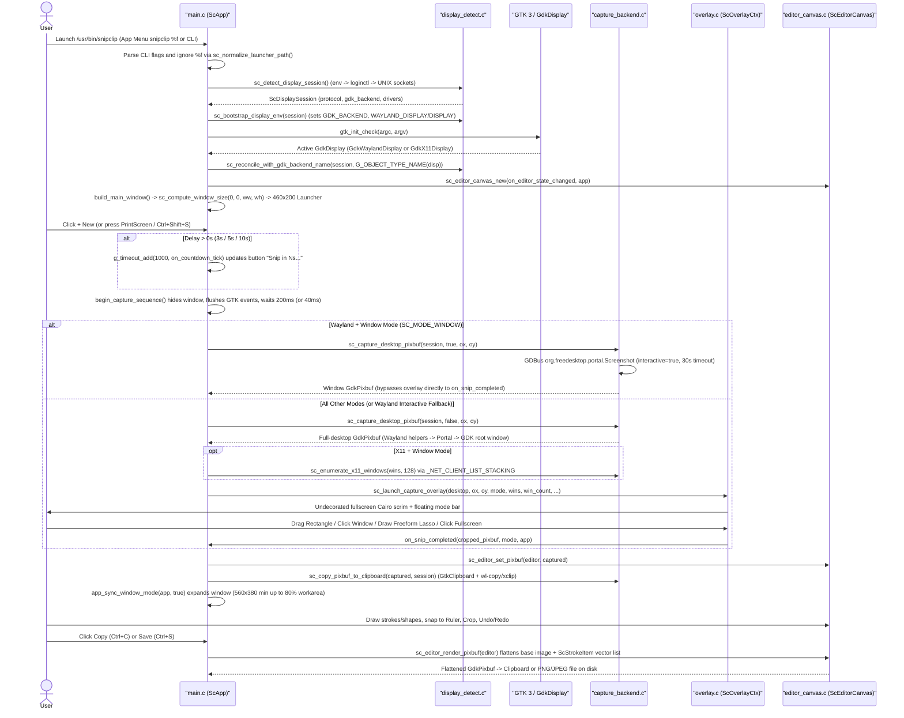
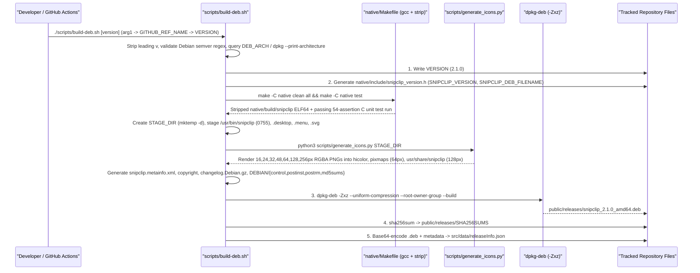

# SnipClip — Exhaustive "As-Is" System Specification (`v2.1.0`)

> **Document Scope & Ground-Truth Guarantee**: This specification documents the exact, verified **as-is** implementation of the `ddastoor/SnipClip` repository at commit `fccf817` (`main`, version `2.1.0`). Every file path, C struct, GTK widget hierarchy, TypeScript interface, CLI flag, GDBus call, Debian packaging rule, environment variable, and test assertion below has been verified directly against source files and live execution.

---

## 1. Project Overview & Core Purpose

**SnipClip** brings the **Microsoft Windows 11 Snipping Tool** workflow to Debian-based Linux distributions (**Debian 12 Bookworm**, **Debian 13 Trixie**, **Ubuntu 22.04 / 24.04 / 24.10 / 25.04**, **Kubuntu**, **Linux Mint 21/22**, **Pop!\_OS**, **Kali Linux**, **Zorin OS**, and **MX Linux**) with zero command-line configuration required for end users.

The repository implements a **dual-surface architecture** synchronized to a single semantic version (`VERSION` = `2.1.0`):

1. **Native Compiled Linux Desktop Application (`native/`, `packaging/`, `scripts/`)**:
   - Produces a stripped 64-bit C11 ELF executable (`/usr/bin/snipclip`, compiled from `native/src/*.c` with GTK 3, Cairo, GdkPixbuf, GIO/GDBus, and `libX11`) packaged inside an `xz`-compressed Debian binary archive (`snipclip_2.1.0_amd64.deb`).
   - **Zero interpreted runtime dependencies**: `/usr/bin/snipclip` contains no Python, Node.js, or Electron runtime; `python3` is used only at build time (`scripts/generate_icons.py`) and in the integration test suite (`linux/tests/test_native_elf_and_deb.py`).
   - **Automatic GUI Startup Display Detection**: Prior to calling `gtk_init_check()`, the binary executes a 7-tier cascade across `XDG_SESSION_TYPE`, `WAYLAND_DISPLAY`, `DISPLAY`, `loginctl`, `$XDG_RUNTIME_DIR/wayland-*` (or `/run/user/<uid>/wayland-*`), and `/tmp/.X11-unix/X*` sockets, bootstraps `GDK_BACKEND` / `WAYLAND_DISPLAY` / `XDG_RUNTIME_DIR` / `DISPLAY`, and reconciles against the live `GdkDisplay` runtime type (`GdkWaylandDisplay` vs `GdkX11Display`).
   - **Windows 11 Snipping Tool UX**: Opens in a compact **`460×200` px** launcher window; supports **4 snip modes** (`Rectangle`, `Window`, `Fullscreen`, `Freeform` lasso), **4 delay timers** (`0s`, `3s`, `5s`, `10s`), **10 canvas tools** (`Pen`, `Highlighter`, `Eraser`, `Rect`, `Ellipse`, `Line`, `Arrow`, `Redact`, `Pixelate`/`Blur`, `Crop`), a draggable/rotatable **graduated Ruler** (`0°–180°` display with straight-edge stroke snapping), **Zoom** (`25%–400%`), **40-step Undo/Redo**, dual-layer **Clipboard persistence** (`GtkClipboard` + `wl-copy` or `xclip`), and **PNG/JPEG file export**.

2. **Interactive React 19 + TypeScript Web Workbench (`src/`, `index.html`, `public/`)**:
   - A client-side Vite 6 Single-Page Application (SPA) styled with Tailwind CSS v4 that runs completely in the browser with **zero backend server**.
   - Provides three interactive sections:
     1. **Snipping Studio (`src/components/SnipStudio.tsx`)**: A live HTML5 `<canvas>` simulation of the `460×200` launcher, simulated `1120×620` Debian 12 desktop (`src/utils/desktopScene.ts`), fullscreen capture overlay, all 4 snip modes, delay countdowns, all 10 annotation tools + ruler + crop + zoom + undo/redo, `localStorage`-backed `PrintScreen` / custom shortcut recorder, clipboard export, and PNG download.
     2. **Display Detection Explorer (`src/components/DisplayDetectionPanel.tsx`)**: Interactive simulator for testing how session environment variables (`XDG_SESSION_TYPE`, `WAYLAND_DISPLAY`, `DISPLAY`, `XDG_CURRENT_DESKTOP`) and optional helper binaries (`xdg-desktop-portal`, `grim`, `wl-copy`, `xclip`, `spectacle`, `gnome-screenshot`) resolve SnipClip's startup capture and clipboard pipeline, coupled live to the Snipping Studio's simulated desktop.
     3. **Debian Package & GitHub Release Showcase (`src/components/DebReleaseSection.tsx`)**: Displays `src/data/releaseInfo.json` metadata, interactive GitHub tag-to-`.deb` version sync preview, inspectable `DEBIAN/control` / `release-deb.yml` / `.deb` file tree tabs, and a magic-byte verified (`!<arch>\n` + `debian-binary`) `.deb` and `SHA256SUMS` downloader (`src/utils/debDownload.ts`) backed by embedded base64 (`debBase64`) with static `/releases/snipclip_2.1.0_amd64.deb` fallback.

---

## 2. Tech Stack, Versions & Runtime Requirements

### 2.1 Toolchain & Library Versions: Cloud VM vs. Official Release Container

| Layer / Component | Cloud VM Environment (Verified As-Is) | Official Release Container (`.github/workflows/release-deb.yml`) | Role in SnipClip |
| :--- | :--- | :--- | :--- |
| **Operating System** | Ubuntu `24.04.5 LTS` (Noble Numbat, `amd64`) | `debian:bookworm` (Debian 12, `amd64`) | Build & test host OS |
| **C Compiler** | `gcc` `13.3.0` (`-std=c11 -O2 -Wall -Wextra -U_FORTIFY_SOURCE -D_FORTIFY_SOURCE=2`) | `gcc` `12.2.0` (Debian Bookworm `build-essential`) | Compiles `native/build/snipclip` and `native/build/test_snipclip_native` |
| **Build Automation** | GNU Make `4.3`, `pkg-config` `1.8.1`, `binutils` (`strip`, `ar`, `objdump`) | GNU Make `4.3`, `pkg-config`, `binutils` | Native C compilation, symbol stripping, ELF/ar inspection |
| **GNU C Library (`libc6`)** | `GLIBC 2.39` (emits `GLIBC_2.38` symbol ceiling in local `.deb`) | `GLIBC 2.36` (enforces `<= GLIBC_2.36` ceiling for multi-distro `.deb` portability) | Standard C / POSIX runtime (`libc.so.6`, `libm.so.6`) |
| **GTK 3 (`gtk+-3.0`)** | `3.24.41` (`libgtk-3-dev` / `libgtk-3-0t64`) | `3.24.38` (`libgtk-3-dev` / `libgtk-3-0`) | Native windowing, widgets, CSS provider, clipboard, dialogs |
| **GLib / GIO / GDBus (`gio-2.0`)** | `2.80.0` (`libglib2.0-0t64`) | `2.74.6` (`libglib2.0-0`) | Main loop, process spawning, D-Bus XDG Desktop Portal client |
| **Cairo (`cairo`)** | `1.18.0` (`libcairo2`) | `1.16.0` (`libcairo2`) | 2D vector rendering for overlay cutouts, ink strokes, shapes, ruler, mosaic |
| **GdkPixbuf (`gdk-pixbuf-2.0`)** | `2.42.10` | `2.42.10` | Raster pixel buffers, cropping, PNG/JPEG encoding/decoding |
| **X11 Client Library (`x11`)** | `1.8.7` (`libx11-dev` / `libx11-6`) | `1.8.4` (`libx11-dev` / `libx11-6`) | Direct `_NET_CLIENT_LIST_STACKING` & `XTranslateCoordinates` window snapping |
| **Debian Packager** | `dpkg-deb` `1.22.6` (forced `-Zxz --uniform-compression`) | `dpkg-deb` `1.21.22` (`-Zxz --uniform-compression`) | Builds `snipclip_2.1.0_amd64.deb` without Ubuntu's default `zstd` compression |
| **Headless X Server** | `Xvfb` `2:21.1.12` + `xauth` | Installed in `.github/workflows/ci.yml` (`ubuntu-latest`) | Executes live GTK 3 `--print-ui-metrics` window dimension test |
| **Python** | `Python 3.12.16` (stdlib only: `zlib`, `struct`, `unittest`, `xml.etree`) | `Python 3.11.x` (Debian Bookworm `python3`) | Build-time PNG icon generator & ELF/`.deb` integration test runner |
| **Node.js & npm** | Node.js `v22.23.5`, `npm` `12.2.2` | Node.js `22` (`actions/setup-node@v4` in `ci.yml`) | Web Workbench dev server, production bundle, and `node:test` runner |

> [!IMPORTANT]
> **ABI Portability Distinction (`GLIBC_2.38` vs `GLIBC_2.36`)**: Because `public/releases/snipclip_2.1.0_amd64.deb` currently committed in Git (`sha256: 3ba35086...`, built `2026-11-23T19:06:45Z`) was built on Ubuntu 24.04 (`GLIBC 2.39` with `-D_FORTIFY_SOURCE=2`), `objdump -T` shows its embedded `/usr/bin/snipclip` references `GLIBC_2.38`. Consequently, the in-repo `.deb` binary executes natively on Ubuntu 24.04+ and Debian 13+, whereas official GitHub Release `.deb` assets built by `.github/workflows/release-deb.yml` inside `debian:bookworm` cap symbols at `<= GLIBC_2.36` so they also run on Debian 12 and Ubuntu 22.04.

### 2.2 Web Workbench `package.json` Dependencies

No lockfile (`package-lock.json`, `pnpm-lock.yaml`, or `yarn.lock`) is committed to the repository; CI and `.agents/environment.json` install via `npm install --no-package-lock --no-audit --no-fund` when `package-lock.json` is absent.

**Runtime `dependencies` (`package.json` lines 14–18)**:
- `react`: `^19.0.0` — UI component rendering (`StrictMode`, hooks).
- `react-dom`: `^19.0.0` — DOM root mounting (`createRoot`).
- `lucide-react`: `^0.511.0` — Crisp vector toolbar and action icons (`27` named icon imports across `Header.tsx`, `DebReleaseSection.tsx`, and `SnipStudio.tsx`).

**Development `devDependencies` (`package.json` lines 19–29)**:
- `vite`: `^6.2.0` — Dev server (`port: 3000`) and Rollup-based static asset bundler (`dist/`).
- `@vitejs/plugin-react`: `^4.4.1` — React Fast Refresh / JSX transform plugin for Vite.
- `tailwindcss`: `^4.1.0` & `@tailwindcss/vite`: `^4.1.0` — CSS-first Tailwind v4 utility engine (`@import "tailwindcss";` in `src/index.css`).
- `typescript`: `~5.8.2` — Static typechecker (`tsc --noEmit` via `npm run lint`).
- `tsx`: `^4.19.0` — TypeScript execution wrapper used to run `node:test` (`npx --yes tsx --test src/utils/snipEngine.test.ts`).
- `@types/node`: `^22.14.0`, `@types/react`: `^19.0.0`, `@types/react-dom`: `^19.0.0` — TypeScript ambient definitions.

### 2.3 Local Debian / Ubuntu `apt` Prerequisites

- **Build & Test Dependencies** (required to compile `native/`, build `.deb`, and run all tests):
  ```bash
  sudo apt-get update && sudo apt-get install -y \
    build-essential pkg-config libgtk-3-dev libx11-dev \
    dpkg-dev binutils python3 xvfb xauth
  ```
- **End-User `.deb` Runtime `Depends`** (`scripts/build-deb.sh` line 30):
  `libc6 (>= 2.35), libgtk-3-0t64 | libgtk-3-0, libglib2.0-0t64 | libglib2.0-0, libcairo2, libx11-6`
- **End-User `.deb` Runtime `Recommends`** (`scripts/build-deb.sh` line 31):
  `xdg-desktop-portal, xdg-desktop-portal-gtk | xdg-desktop-portal-kde | xdg-desktop-portal-gnome, wl-clipboard, xclip, grim, desktop-file-utils, shared-mime-info`

---

## 3. Annotated Repository Map

All tracked files in Git (`git ls-files --stage`) carry file mode `100644`—including `scripts/build-deb.sh`, `scripts/generate_icons.py`, and `scripts/run-tests.sh` (none have the `100755` executable bit committed in Git).

```text
SnipClip/
├── .agents/
│   └── environment.json                    # Cloud VM bootstrap command: apt-get native deps + npm install + make -C native all
├── .github/
│   └── workflows/
│       ├── ci.yml                          # Push/PR CI on ubuntu-latest: apt deps, Node 22, build-deb.sh, run-tests.sh, npm run build
│       └── release-deb.yml                 # Release pipeline in debian:bookworm container: builds ABI-portable .deb + publishes GitHub Release
├── linux/
│   └── tests/
│       ├── __pycache__/                    # [GITIGNORED] Python 3.12 bytecode cache from unittest runs
│       └── test_native_elf_and_deb.py      # 8-method Python unittest suite verifying ELF64 magic, ldd/GLIBC, CLI JSON, Xvfb 460x200 UI, xz .deb, t64 deps, md5sums/AppStream
├── native/
│   ├── build/                              # [GITIGNORED] Compiled C artifacts: stripped `snipclip` ELF + `test_snipclip_native` binary
│   ├── include/
│   │   ├── capture_backend.h               # Screen capture, libX11 window enumeration (SC_MAX_WINDOWS=128), and clipboard daemon declarations
│   │   ├── display_detect.h                # ScDisplayProtocol, ScDisplaySession, 7-tier detector, env bootstrap, GdkDisplay reconciler, JSON serializer, path normalizer
│   │   ├── editor_canvas.h                 # Opaque ScEditorCanvas widget API: tools, ink color/width, ruler, zoom, 40-step undo/redo, crop, flattened pixbuf export
│   │   ├── geometry.h                      # Pure math types (ScSnipMode, ScToolKind, ScPoint, ScRect, ScRuler), window-sizing constants (460x200), hit-testing & ruler snapping APIs
│   │   ├── overlay.h                       # Fullscreen capture overlay launcher API (sc_launch_capture_overlay) & completion/cancellation callbacks
│   │   └── snipclip_version.h              # Auto-generated C macros (SNIPCLIP_VERSION="2.1.0", SNIPCLIP_DEB_FILENAME, SNIPCLIP_RELEASE_TAG) synced by scripts/build-deb.sh
│   ├── src/
│   │   ├── capture_backend.c               # GDBus XDG Portal Screenshot client, grim/spectacle/gnome-screenshot fallbacks, GDK root grab, libX11 stacking query, wl-copy/xclip pipe
│   │   ├── display_detect.c                # Environment/socket/loginctl Wayland & X11 detection cascade, GDK_BACKEND bootstrap, JSON formatter, %f / file:// URI decoder
│   │   ├── editor_canvas.c                 # Cairo custom GtkDrawingArea annotation engine, 10x10 pixelate mosaic, graduated ruler, crop overlay, undo/redo snapshot stacks
│   │   ├── geometry.c                      # Pure C11 math implementation (rect normalization, polygon bbox/raycast, arrow wings, ruler fit/snap, segment distance, window sizing)
│   │   ├── main.c                          # CLI parser, GTK startup lifecycle, embedded CSS, 460x200 launcher & dynamic editor UI, shortcut recorder dialog, file open/save
│   │   └── overlay.c                       # Undecorated fullscreen Cairo overlay, floating mode switcher pill, even-odd dim cutout, live pixel dimensions badge, freeform clip
│   ├── tests/
│   │   └── test_native.c                   # Headless C11 unit test binary (4 test suites, 54 assert() checks) linked without GTK/X11 dependencies
│   └── Makefile                            # Builds build/snipclip (C11 + gtk+-3.0 + gio-2.0 + x11 + -lm, stripped) and build/test_snipclip_native (-lm)
├── packaging/
│   ├── snipclip.desktop                    # Freedesktop launcher (`Exec=snipclip %f`) + 3 desktop context actions (RectSnip, WindowSnip, FullSnip)
│   ├── snipclip.menu                       # Legacy Debian Menu entry (`Applications/Graphics`, `/usr/bin/snipclip`)
│   └── snipclip.svg                        # Scalable 128x128 vector app icon (dark slate badge #0F172A, dashed cyan frame #38BDF8, white scissors #F8FAFC)
├── public/
│   ├── assets/
│   │   └── aistudio/
│   │       └── image_53746529.png          # Legacy Google AI Studio scaffold asset (unreferenced by application code)
│   └── releases/
│       ├── SHA256SUMS                      # Standard sha256sum manifest for snipclip_2.1.0_amd64.deb
│       └── snipclip_2.1.0_amd64.deb        # Built xz-compressed Debian binary package (48,908 bytes) served statically at /releases/snipclip_2.1.0_amd64.deb
├── scripts/
│   ├── build-deb.sh                        # [Mode 100644 in Git] Master release script: syncs VERSION + snipclip_version.h, compiles C, stages .deb, writes SHA256SUMS & releaseInfo.json
│   ├── generate_icons.py                   # [Mode 100644 in Git] Deterministic pure-Python 2x2-supersampled SDF rasterizer generating 16..256px hicolor/pixmap/app PNG icons
│   └── run-tests.sh                        # [Mode 100644 in Git] 4-stage unified test runner: C unit tests -> Python ELF/.deb tests -> TS node:test -> tsc --noEmit
├── src/
│   ├── components/
│   │   ├── DebReleaseSection.tsx           # Web section #debian-package & #github-release: package metrics, GUI/apt instructions, tag->version simulator, file tabs, .deb download
│   │   ├── DisplayDetectionPanel.tsx       # Web section #display-detection: 5 Linux desktop presets, live env/binary controls, resolved 7-row startup telemetry table
│   │   ├── Header.tsx                      # Sticky top navigation bar (#studio, #display-detection, #debian-package, #github-release) + primary Download .deb CTA
│   │   └── SnipStudio.tsx                  # Web section #studio: interactive 460x200 launcher, 1120x620 capture overlay, dynamic annotation editor, shortcut recorder
│   ├── data/
│   │   └── releaseInfo.json                # Auto-generated 14-key JSON artifact manifest including full base64-encoded .deb payload (`debBase64`, ~66 KB total file)
│   ├── utils/
│   │   ├── debDownload.ts                  # Base64 decoder, Debian `!<arch>\n` + `debian-binary` magic-byte validator, and Blob download triggers
│   │   ├── desktopScene.ts                 # Procedural 1120x620 Debian 12 desktop wallpaper & 3 simulated application windows rendered to offscreen HTMLCanvasElement
│   │   ├── snipEngine.test.ts              # 17-test Node `node:test` suite testing TS geometry/detection/shortcuts + cross-stack parity across VERSION, C header, ELF, and .deb
│   │   └── snipEngine.ts                   # Pure TypeScript domain engine (3 enums, 14 interfaces, 8 constants, 17 exported functions) mirroring native C logic
│   ├── App.tsx                             # Top-level React state coordinator linking session presets/custom env inputs across SnipStudio, DisplayDetectionPanel, and DebReleaseSection
│   ├── index.css                           # Tailwind CSS v4 import and custom `@theme` typography tokens (`Plus Jakarta Sans`, `JetBrains Mono`)
│   └── main.tsx                            # Browser React 19 entry point mounting `<StrictMode><App /></StrictMode>` into `#root`
├── dist/                                   # [GITIGNORED] Vite production build output (`dist/index.html`, `dist/assets/*`, copied `public/*`)
├── node_modules/                           # [GITIGNORED] Installed npm packages
├── .env.example                            # Sanitized environment variable reference template (documents runtime/build/CI variables + unused legacy GEMINI_API_KEY)
├── .gitignore                              # Ignores node_modules/, dist/, native/build/, __pycache__/, *.py[cod], .DS_Store, *.swp
├── AGENTS.md                               # Google Antigravity workspace bootstrap rules & engineering invariants (plain Markdown, no YAML frontmatter)
├── index.html                              # Vite HTML entry shell loading Google Fonts (`Plus Jakarta Sans`, `JetBrains Mono`) and `/src/main.tsx`
├── metadata.json                           # Legacy Google AI Studio project metadata file (`MAJOR_CAPABILITY_SERVER_SIDE_GEMINI_API` remnant; unused at runtime)
├── package.json                            # Web Workbench manifest (`version: "2.1.0"`, `"type": "module"`, 6 npm scripts)
├── README.md                               # Public-facing overview, graphical `.deb` install instructions, and build/test quickstart
├── SPEC.md                                 # This exhaustive "As-Is" System Specification
├── todo.md                                 # Actionable Cloud-to-Local continuation checklist, triage log, and prioritized roadmap
├── tsconfig.json                           # TypeScript ~5.8.2 compiler config (`strict: true`, `noEmit: true`, `moduleResolution: "bundler"`, `@/*` path alias)
├── VERSION                                 # Single-line canonical semantic version source of truth (`2.1.0\n`)
└── vite.config.ts                          # Vite 6 config (`react()`, `tailwindcss()`, `@` alias, `port: 3000`, `host: '0.0.0.0'`, `allowedHosts: true`, `DISABLE_HMR` toggle)
```

---

## 4. System Architecture & Execution Flows

### 4.1 Component Architecture Diagram

```mermaid
graph TD
    subgraph Shared_Truth["Version & Artifact Synchronization"]
        VER["VERSION (2.1.0)"]
        BLD["scripts/build-deb.sh"]
        ICONS["scripts/generate_icons.py"]
        VHDR["native/include/snipclip_version.h"]
        DEB["public/releases/snipclip_2.1.0_amd64.deb"]
        SUMS["public/releases/SHA256SUMS"]
        RJSON["src/data/releaseInfo.json (includes debBase64)"]
    end

    subgraph Native_GTK_App["Native Linux Desktop App (/usr/bin/snipclip)"]
        MAIN["native/src/main.c (CLI + GtkWindow + Shortcuts)"]
        DDET["native/src/display_detect.c (7-Tier X11/Wayland Cascade)"]
        GEOM["native/src/geometry.c (Pure C11 Math & Sizing)"]
        CAP["native/src/capture_backend.c (Capture + Window Tree + Clipboard)"]
        OVL["native/src/overlay.c (Fullscreen Cairo Overlay)"]
        ED["native/src/editor_canvas.c (Cairo Annotation & Crop Engine)"]
    end

    subgraph Linux_OS_Interfaces["Linux Desktop & Session Services"]
        PORTAL["GDBus org.freedesktop.portal.Screenshot"]
        WL_CLI["Wayland Helpers (grim / spectacle / gnome-screenshot / wl-copy)"]
        X11_LIB["libX11 (_NET_CLIENT_LIST_STACKING) + GDK Root Pixbuf + xclip"]
        LOGINCTL["systemd loginctl + Wayland/X11 UNIX Sockets"]
    end

    subgraph Web_Workbench["React 19 + Vite 6 Web Workbench (src/)"]
        APP["src/App.tsx"]
        HDR["src/components/Header.tsx"]
        STUDIO["src/components/SnipStudio.tsx"]
        DPANEL["src/components/DisplayDetectionPanel.tsx"]
        DEBSEC["src/components/DebReleaseSection.tsx"]
        SENG["src/utils/snipEngine.ts (17 Pure Functions)"]
        DSCENE["src/utils/desktopScene.ts (1120x620 Simulated Desktop)"]
        DDOWN["src/utils/debDownload.ts (ar Magic-Byte Verifier)"]
    end

    VER --> BLD
    ICONS --> BLD
    BLD --> VHDR
    BLD --> DEB
    BLD --> SUMS
    BLD --> RJSON

    VHDR --> MAIN
    MAIN --> DDET
    MAIN --> GEOM
    MAIN --> CAP
    MAIN --> OVL
    MAIN --> ED
    OVL --> GEOM
    ED --> GEOM
    DDET --> LOGINCTL
    CAP --> PORTAL
    CAP --> WL_CLI
    CAP --> X11_LIB

    RJSON --> APP
    DEB -. "Fallback fetch(/releases/...)" .-> DDOWN
    APP --> HDR
    APP --> STUDIO
    APP --> DPANEL
    APP --> DEBSEC
    STUDIO --> SENG
    STUDIO --> DSCENE
    DPANEL --> SENG
    DEBSEC --> SENG
    DEBSEC --> DDOWN
    APP --> DDOWN
```



### 4.2 End-to-End Flow A: Native `/usr/bin/snipclip` Startup, Capture, Overlay, Annotation & Export



### 4.3 End-to-End Flow B: `scripts/build-deb.sh` 5-Artifact Build & Parity Pipeline



### 4.4 Detailed Application Lifecycle Walkthrough

#### Native GTK 3 Binary (`native/src/main.c`)
1. **Process Identity & Resilient CLI Parsing (`main`, lines 1105–1167)**:
   - Sets `g_set_prgname("snipclip")` and `g_set_application_name("SnipClip")` so Wayland compositors and X11 window managers match `StartupWMClass=snipclip` in `snipclip.desktop`.
   - Iterates `argv[1..argc-1]` with a resilient parser that handles `-h`/`--help`, `-v`/`--version`, `--detect-display`, `--print-ui-metrics`, `--capture-now`, `-m`/`--mode[=]` (`rectangle|window|fullscreen|freeform`), `-d`/`--delay[=]` (`0|3|5|10`), and `--shortcut[=]`.
   - Unknown flags starting with `-` are silently ignored so desktop environments passing extra launcher flags never crash startup.
   - Positional arguments not starting with `-` pass through `sc_normalize_launcher_path()` (`display_detect.c` lines 486–519), which ignores blank strings and unexpanded Freedesktop placeholders (`%f`, `%F`, `%u`, `%U`, `%i`, `%c`, `%k`), strips `file://` and `file://localhost/`, and percent-decodes `%XX` hex sequences (e.g., `%20` -> space).
   - `--help` and `--version` print to `stdout` and return `0` immediately before any OS display probing or GTK initialization.
2. **7-Tier Pre-GTK Display Detection (`sc_detect_display_session`, `display_detect.c` lines 350–386)**:
   - Discovers candidate Wayland UNIX sockets (`wayland-[0-9]*`, skipping `*.lock`, verified with `S_ISSOCK`, choosing lexicographically smallest such as `wayland-0`) inside `$XDG_RUNTIME_DIR` or `/run/user/<uid>`.
   - Discovers candidate X11 UNIX sockets (`X[0-9]+`, verified with `S_ISSOCK`, choosing lowest display number `:<N>`) inside `/tmp/.X11-unix`.
   - Only invokes `probe_loginctl_type()` when `XDG_SESSION_TYPE` is neither `"wayland"` nor `"x11"` and `WAYLAND_DISPLAY` is empty.
   - Evaluates `sc_detect_display_session_custom()` (`lines 251–348`) in strict priority order:
     1. `XDG_SESSION_TYPE == "wayland"` -> `SC_PROTO_WAYLAND` (fills `wayland_display` from discovered socket if env var was unset).
     2. `XDG_SESSION_TYPE == "x11"` -> `SC_PROTO_X11` (fills `x11_display` from discovered socket if env var was unset).
     3. `WAYLAND_DISPLAY != ""` -> `SC_PROTO_WAYLAND` (resolves XWayland ambiguity where both `WAYLAND_DISPLAY` and `DISPLAY` are set).
     4. `DISPLAY != ""` **and** `loginctl_type != "wayland"` -> `SC_PROTO_X11` (ensures explicit `DISPLAY=:99` Xvfb/SSH sessions win over stale unreferenced `wayland-0` sockets unless `loginctl` confirms an active Wayland session).
     5. `loginctl_type` is `"wayland"` or `"x11"` -> matching protocol + socket backfill.
     6. Discovered live Wayland UNIX socket (`wayland-0`) -> `SC_PROTO_WAYLAND` (handles stripped GUI package-installer environments like KDE Discover / PackageKit with empty env vars).
     7. Discovered live X11 UNIX socket (`/tmp/.X11-unix/X0`) -> `SC_PROTO_X11`.
     8. Fallback -> `SC_PROTO_HEADLESS` (`gdk_backend = "broadway"`).
   - If `--detect-display` was passed, formats JSON via `sc_format_display_session_json()`, prints to `stdout`, and exits `0`.
3. **Environment Bootstrap & `gtk_init_check` Reconciliation (`main.c` lines 1178–1192)**:
   - `sc_bootstrap_display_env()` sets `GDK_BACKEND` (`"wayland,x11"` for Wayland, `"x11"` for X11) only if `GDK_BACKEND` is unset/empty; backfills empty `WAYLAND_DISPLAY`, `XDG_RUNTIME_DIR` (`/run/user/<uid>` if directory exists), or `DISPLAY`.
   - Calls `gtk_init_check(&argc, &argv)`. If no display server is reachable, prints `"SnipClip Error: Unable to connect to an active Wayland or X11 display server.\n"` to `stderr` and exits `1`.
   - Queries `G_OBJECT_TYPE_NAME(gdk_display_get_default())` and runs `sc_reconcile_with_gdk_backend_name()`: if GTK fell back from Wayland to XWayland (`GdkX11Display`) or connected to Wayland (`GdkWaylandDisplay`) from a previously headless state, updates `protocol`, `protocol_name`, `detection_source`, `gdk_backend`, `capture_driver`, `clipboard_driver`, and `supports_window_enumeration` to match reality.
4. **Dual-Mode Window Construction (`build_main_window`, `main.c` lines 768–1087)**:
   - Loads `APP_CSS` at `GTK_STYLE_PROVIDER_PRIORITY_APPLICATION`.
   - Builds a 5-row vertical `GtkBox`:
     - **Row 1 (`cmd_bar`)**: `+ New` button, Mode `GtkComboBoxText`, Delay `GtkComboBoxText`, expanding spacer, `editor_actions_box` (`Undo`, `Redo`, `Copy`, `Save` — hidden in launcher mode via `hide_with_no_show_all`), `Open` button, and `⋯` `GtkMenuButton` popover (`Shortcut: ...`, `Close Current Snip`, `Display & Version`).
     - **Row 2 (`annot_scroll`)**: Horizontally scrollable (`GTK_POLICY_AUTOMATIC`, `GTK_POLICY_NEVER`) strip with 10 tool buttons (`Pen`, `Highlight`, `Eraser`, `Rect`, `Ellipse`, `Line`, `Arrow`, `Redact`, `Blur`, `Crop`), `Ruler` toggle, `GtkColorButton` (`#ef4444` default), `GtkScale` stroke width (`1..16`, default `3`), and `Clear Ink` — hidden in launcher mode.
     - **Row 3 (`crop_banner`)**: Contextual blue banner (`Apply Crop`, `Cancel`) — shown only when `has_img && sc_editor_is_crop_active()`.
     - **Row 4 (`scroll`)**: `GtkScrolledWindow` wrapping `ScEditorCanvas`'s `GtkDrawingArea` (draws centered prompt `"Click '+ New' or press PrintScreen to snip"` when empty).
     - **Row 5 (`status_bar`)**: Session summary, status message, dimensions (`"W x H px"`), and zoom percentage (`"100%"`) — hidden in launcher mode.
   - Computes initial window size via `sc_compute_window_size()`: `460×200` when empty; `clamp(image_w + 48, 560, 0.80 * workarea_w) × clamp(image_h + 136, 380, 0.80 * workarea_h)` when an initial image is loaded.
   - If `--capture-now` (`autostart == true`), only presents the launcher window first if `delay_seconds > 0` (so user sees countdown), and schedules `on_autostart_snip` via `g_idle_add()`.
5. **Teardown (`main.c` lines 739–745, 1249–1253)**:
   - Closing the main window emits `"destroy"` -> `on_window_destroy()` -> `gtk_main_quit()`.
   - `sc_editor_canvas_free(app.editor)` frees the base `GdkPixbuf`, active/committed `ScStrokeItem` point arrays, and all 40-slot undo/redo `ScSnapshot` buffers before returning `0`.
   - Any background `wl-copy` or `xclip` child process spawned via `g_spawn_async_with_pipes()` intentionally outlives `snipclip` so clipboard contents remain available for pasting after window closure.

#### Web Workbench (`src/main.tsx` -> `src/App.tsx`)
1. `index.html` loads `Plus Jakarta Sans` and `JetBrains Mono` from Google Fonts and executes `/src/main.tsx`.
2. `src/main.tsx` mounts `<StrictMode><App /></StrictMode>` into `#root`.
3. `src/App.tsx` initializes `activePresetId`, `env`, and `bins` from `SESSION_PRESETS[0]` (`debian-gnome-wayland`), computes `detectedSession = useMemo(() => detectLinuxDisplaySession(env, bins), [env, bins])`, and passes `releaseData` (statically imported from `src/data/releaseInfo.json`) plus `detectedSession` down to `Header`, `SnipStudio`, `DisplayDetectionPanel`, and `DebReleaseSection`.
4. `SnipStudio.tsx` reads `snipclip.printScreenEnabled` and `snipclip.customShortcut` from `window.localStorage` (wrapped in `try/catch` for sandboxed iframes), renders `simulatedDesktop` via `renderSimulatedDebianDesktop()`, and attaches capture-phase `keydown` and `keyup` listeners on `window` (cleaned up on unmount).

---

## 5. Module-by-Module Functional Breakdown

### 5.1 Native C Modules (`native/include/` & `native/src/`)

#### 5.1.1 `native/include/snipclip_version.h`
- **Role**: Compile-time version and release artifact constants rewritten on every `./scripts/build-deb.sh` run.
- **Macros**: `SNIPCLIP_NAME` (`"SnipClip"`), `SNIPCLIP_PKG_NAME` (`"snipclip"`), `SNIPCLIP_VERSION` (`"2.1.0"`), `SNIPCLIP_DEB_ARCH` (`"amd64"`), `SNIPCLIP_DEB_FILENAME` (`"snipclip_2.1.0_amd64.deb"`), `SNIPCLIP_RELEASE_TAG` (`"v2.1.0"`).

#### 5.1.2 `native/include/geometry.h` & `native/src/geometry.c`
- **Role**: Zero-GTK, zero-X11 pure C11 geometric and layout math library (`-lm` only), shared between `snipclip` and `test_snipclip_native`.
- **Constants**: `SC_LAUNCHER_WIDTH = 460`, `SC_LAUNCHER_HEIGHT = 200`, `SC_EDITOR_MIN_WIDTH = 560`, `SC_EDITOR_MIN_HEIGHT = 380`, `SC_EDITOR_CHROME_W = 48`, `SC_EDITOR_CHROME_H = 136`.
- **Public Functions**:
  - `sc_normalize_rect(x1, y1, x2, y2, max_w, max_h)` -> `ScRect`: Orders inverted drag coordinates, clamps to `[0, max_w] × [0, max_h]` when `max_w/max_h > 0`, rounds via `llround`.
  - `sc_polygon_bbox(pts, count, max_w, max_h, out_rect)` -> `bool`: Computes clamped integer bounding box (`floor` min, `ceil` max) for `>= 3` points; rejects degenerate polygons narrower or shorter than `8 px`.
  - `sc_point_in_polygon(px, py, pts, count)` -> `bool`: Even-odd ray-casting point-in-polygon test (with `1e-12` division guard).
  - `sc_compute_arrow_wings(x1, y1, x2, y2, stroke_width, out_left, out_right)`: Computes arrowhead wing endpoints using `head_len = fmax(12.0, stroke_width * 4.2)` and spread angle `M_PI / 6.5` (~`27.7°`).
  - `sc_fit_ruler_to_canvas(canvas_w, canvas_h, visible, angle_deg)` -> `ScRuler`: Centers ruler on `max(80, canvas_w/h)`, sets `length = round(clamp(safe_w - 56, 140, 380))`, `half_thickness = round(clamp(safe_h * 0.10, 18, 26))`, normalizes `angle_deg` into `[0, 360)`.
  - `sc_point_inside_ruler(px, py, ruler)` -> `bool`: Projects point onto ruler's local rotated basis `(dx, dy)` and `(nx, ny)`; returns `true` when `|along| <= length/2` and `|perp| <= half_thickness`.
  - `sc_snap_point_to_ruler(px, py, ruler, snap_threshold)` -> `ScPoint`: When `ruler->visible`, `|along| <= length/2 + 16.0`, and `|perp ± half_thickness| <= snap_threshold`, projects `(px, py)` orthogonally onto the nearer straight edge of the ruler.
  - `sc_distance_to_segment(px, py, ax, ay, bx, by)` -> `double`: Euclidean point-to-line-segment distance.
  - `sc_hit_test_annotation(px, py, kind, pts, count, threshold)` -> `bool`: Polyline segment hit-testing for `SC_TOOL_PEN`/`SC_TOOL_HIGHLIGHTER`, single-segment hit-testing for `SC_TOOL_LINE`/`SC_TOOL_ARROW`, and expanded bounding-box hit-testing (`± threshold`) for `SC_TOOL_RECT`, `SC_TOOL_ELLIPSE`, `SC_TOOL_REDACT`, `SC_TOOL_PIXELATE`.
  - `sc_compute_window_size(image_w, image_h, workarea_w, workarea_h, out_w, out_h)`: Computes `460×200` launcher size (clamped to `workarea - 32` when `workarea > 120`) or editor size (`image + 48×136`, clamped between `560×380` and `80%` of workarea, or `1100×760` fallback when workarea is `0`).
  - `sc_snip_mode_to_string(mode)` / `sc_snip_mode_from_string(str, out_mode)`: Bidirectional serialization for `"rectangle"`, `"window"`, `"fullscreen"`, `"freeform"`.

#### 5.1.3 `native/include/display_detect.h` & `native/src/display_detect.c`
- **Role**: Zero-GTK OS session detector, environment bootstrapper, `GdkDisplay` reconciler, JSON telemetry formatter, and Freedesktop path normalizer.
- **Internal Helpers**:
  - `os_has_binary_cb`: Searches `PATH` (fallback `"/usr/local/bin:/usr/bin:/bin"`) using `access(..., X_OK)` and `stat(..., S_ISREG)`.
  - `discover_wayland_socket_in_dir` & `discover_x11_socket`: `opendir`/`readdir` + `S_ISSOCK` scanners.
  - `probe_loginctl_type`: Reads `XDG_SESSION_ID` (strictly whitelisted to `[A-Za-z0-9_-]` to prevent shell injection in `popen()`), falls back to `loginctl show-user <uid> -p Display --value`, then runs `loginctl show-session <id> -p Type --value`.
  - `populate_protocol_drivers`: Assigns `gdk_backend`, `capture_driver`, `clipboard_driver`, and `supports_window_enumeration` based on detected protocol and installed helper binaries.
- **Public Functions**: `sc_detect_display_session_custom` (dependency-injected for unit tests), `sc_detect_display_session`, `sc_bootstrap_display_env`, `sc_reconcile_with_gdk_backend_name`, `sc_format_display_session_json`, `sc_normalize_launcher_path`.

#### 5.1.4 `native/include/capture_backend.h` & `native/src/capture_backend.c`
- **Role**: OS pixel capture, X11 window stacking enumeration, and clipboard persistence.
- **Key Functions & Behavior**:
  - `capture_via_xdg_portal_gdbus(bool interactive)` (static): Opens synchronous session bus (`g_bus_get_sync`), sanitizes unique bus name (`:1.84` -> `1_84`), generates `snipclip_<pid>_<seq>` request handle token, subscribes to `org.freedesktop.portal.Request::Response` on `/org/freedesktop/portal/desktop/request/<sender>/<token>` (plus dynamic fallback subscription if returned `o` path differs), calls `org.freedesktop.portal.Screenshot.Screenshot("", {handle_token, interactive, modal})` (`5000ms` D-Bus call timeout), runs a private `GMainLoop` with `30000ms` (interactive) or `8000ms` (non-interactive) timeout, loads the returned `file://` URI into a `GdkPixbuf`, **and immediately unlinks (`g_unlink`) the portal's temporary screenshot file** so `/run/user/<uid>` or `~/Pictures` is not polluted.
  - `capture_wayland_fallbacks(void)` (static): Creates `/tmp/snipclip_XXXXXX.png` via `g_file_open_tmp`, tries `grim <tmp>`, then `spectacle -f -b -n -o <tmp>`, then `gnome-screenshot -f <tmp>` via `g_spawn_sync`, loads the resulting `GdkPixbuf`, and unlinks `tmp_path`.
  - `capture_gdk_root_window(out_origin_x, out_origin_y)` (static): Reads `gdk_get_default_root_window()` dimensions and calls `gdk_pixbuf_get_from_window(root, 0, 0, w, h)`.
  - `sc_capture_desktop_pixbuf(session, interactive_window, out_origin_x, out_origin_y)`: Orchestrates Wayland interactive window portal -> Wayland CLI fallbacks -> Wayland non-interactive portal -> X11/XWayland GDK root window fallback.
  - `sc_enumerate_x11_windows(out_windows, max_windows)`: Opens `XOpenDisplay(NULL)`, installs temporary `ignore_x11_errors` trap (preventing `BadWindow` crashes if a window closes mid-query), reads `_NET_CLIENT_LIST_STACKING` (fallback `_NET_CLIENT_LIST`) on `DefaultRootWindow`, iterates **in reverse** (topmost window first) up to `SC_MAX_WINDOWS` (`128`), filters `map_state == IsViewable` and `width >= 24 && height >= 24`, translates `(0,0)` to root coordinates via `XTranslateCoordinates`, and resolves UTF-8 `_NET_WM_NAME` (fallback `XFetchName`, fallback `"Window 0x%lx"`).
  - `sc_copy_pixbuf_to_clipboard(pixbuf, session)`: Stores image in `GtkClipboard` (`GDK_SELECTION_CLIPBOARD`) via `gtk_clipboard_set_image` + `gtk_clipboard_store`, encodes PNG bytes via `gdk_pixbuf_save_to_buffer`, and pipes them asynchronously (`g_spawn_async_with_pipes`) to `wl-copy --type image/png` (Wayland) or `xclip -selection clipboard -t image/png -i` (X11).

#### 5.1.5 `native/include/overlay.h` & `native/src/overlay.c`
- **Role**: Interactive fullscreen capture overlay (`ScOverlayCtx`).
- **Behavior**:
  - If `initial_mode == SC_MODE_FULLSCREEN`, immediately clones `desktop_pixbuf` and invokes `on_completed` without opening an overlay window.
  - Otherwise opens an undecorated, `keep_above`, fullscreen `GtkWindow` containing a `GtkOverlay`: base `GtkDrawingArea` (`GDK_CROSSHAIR` cursor) + top-centered floating `sc-overlay-bar` (`Rectangle`, `Window`, `Fullscreen`, `Freeform`, `Cancel (Esc)`).
  - **Cairo Draw (`on_overlay_draw`)**: Paints `desktop_pixbuf`, draws a `rgba(0.06, 0.09, 0.16, 0.48)` scrim with `CAIRO_FILL_RULE_EVEN_ODD` cutout over the active rectangle, hovered X11 window, or freeform lasso path, strokes a `#38bdf8`-equivalent (`0.22, 0.74, 0.97`) `2px` border, and renders a dark pill badge showing `"W x H px"` or `"<Window Title> (W x H px)"`.
  - **Completion & Cancellation**: Left-drag release crops `>= 6×6 px` rectangles; left-click in Window mode crops hovered X11 window (`>= 8×8 px`) or full desktop fallback; Freeform release (`>= 3` points, bbox `>= 8×8 px`) clips onto a transparent `CAIRO_FORMAT_ARGB32` surface; Right-click (`button == 3`), `Escape`, or `Cancel (Esc)` button cancels. Guards double-invocation via `ctx->finished`.

#### 5.1.6 `native/include/editor_canvas.h` & `native/src/editor_canvas.c`
- **Role**: Opaque custom `GtkDrawingArea` annotation, ruler, zoom, undo/redo, crop, and export widget (`ScEditorCanvas`).
- **Internal State**: Base `GdkPixbuf *pixbuf`, dynamic array of committed `ScStrokeItem` structs, in-progress `active_item`, 40-slot ring-shifted `undo_stack` and `redo_stack` of `ScSnapshot` (deep-copying both `GdkPixbuf` and all `ScStrokeItem` arrays so Crops and Ink Edits share unified undo/redo), active `ScToolKind`, `GdkRGBA color` (`#ef4444` default), `stroke_width` (`3.0` default, Highlighter multiplies width by `4.5` at `0.42` alpha), `zoom` (`[0.25, 4.0]`), `ScRuler`, and crop rect state.
- **Interactions**:
  - Dragging inside `ruler` translates `(ruler.cx, ruler.cy)`; scrolling mouse wheel over `ruler` rotates `ruler.angle_deg` by `±5.0°`; `Ctrl + Scroll` zooms canvas by `±10%`.
  - `SC_TOOL_ERASER` hit-tests strokes from topmost to bottommost within `14.0` image-space pixels (`erase_near_point`) on press and drag.
  - `SC_TOOL_PIXELATE` (`draw_pixelate_mosaic`) renders deterministic `10×10` image-space solid color blocks sampled from the center of each block in the backing `GdkPixbuf`.
  - `SC_TOOL_REDACT` fills solid `#0f172a` (`0.06, 0.09, 0.16`) rectangles.
  - `sc_editor_apply_crop` flattens current annotations via `sc_editor_render_pixbuf`, normalizes `crop_rect` (requiring `>= 8×8 px`), pushes an undo snapshot, replaces `ed->pixbuf` with the cropped sub-pixbuf, clears the vector item list (now baked into `ed->pixbuf`), resets tool to `SC_TOOL_PEN`, and refits the ruler.

#### 5.1.7 `native/src/main.c`
- **Role**: Application shell (`ScApp`), GTK CSS styling, top/annotation/crop/status bars, file dialogs, shortcut recorder dialog, keyboard accelerators, and CLI modes (`--help`, `--version`, `--detect-display`, `--print-ui-metrics`).
- **File Dialogs**:
  - `action_open_file` (`Ctrl+O` / `Open`): `GtkFileChooserDialog` filtered via `gtk_file_filter_add_pixbuf_formats` (`PNG, JPEG, WebP, BMP` and system GdkPixbuf loaders).
  - `action_save_file` (`Ctrl+S` / `Save`): Defaults to `G_USER_DIRECTORY_PICTURES` (`~/Pictures`) and filename `"SnipClip-Capture.png"`, with overwrite confirmation; saves `"jpeg"` if extension ends in `.jpg`/`.jpeg` (case-insensitive), otherwise `"png"`.
- **Custom Shortcut Recorder (`on_shortcut_btn_clicked`)**: Modal `420×150` `GtkDialog` capturing `key-press-event`; accepts standalone `PrintScreen`/`Sys_Req`/`F1..F12` or any non-modifier key combined with `Ctrl`/`Alt`/`Shift`/`Super`.

---

### 5.2 Build, Packaging & Test Modules (`scripts/`, `packaging/`, `native/tests/`, `linux/tests/`)

| File | Primary Symbols / Commands | Inputs | Outputs & Side Effects | Error Handling |
| :--- | :--- | :--- | :--- | :--- |
| `scripts/build-deb.sh` | Bash pipeline (`set -euo pipefail`) | Optional `$1` version, or `GITHUB_REF_NAME`, or `VERSION`; optional `DEB_ARCH` | Rewrites `VERSION`, `native/include/snipclip_version.h`, builds `native/build/*`, stages `.deb` in `mktemp -d`, writes `public/releases/snipclip_<ver>_<arch>.deb`, `public/releases/SHA256SUMS`, `src/data/releaseInfo.json` | Exits `1` on invalid semver regex; `trap 'rm -rf "${STAGE_DIR}"' EXIT` cleans temp dir on any failure |
| `scripts/generate_icons.py` | `_rounded_rect_sdf()`, `_sample_icon_128()`, `render_png_bytes(size)`, `main()` | `<stage_dir>` CLI arg | Writes 8-bit RGBA PNGs (zlib level 9, 2×2 supersampled) at `16,24,32,48,64,128,256` into `usr/share/icons/hicolor/<sz>x<sz>/apps/snipclip.png`, `64px` to `usr/share/pixmaps/snipclip.png`, `128px` to `usr/share/snipclip/snipclip.png` | Exits `1` if `len(sys.argv) != 2` |
| `scripts/run-tests.sh` | 4-stage Bash test runner (`set -euo pipefail`) | None | Runs `make -C native test`, `python3 -m unittest discover -s linux/tests -p "test_*.py" -v`, `npx --yes tsx --test src/utils/snipEngine.test.ts`, `npm run lint` | Aborts immediately on first non-zero stage exit |
| `packaging/snipclip.desktop` | `[Desktop Entry]` + 3 `[Desktop Action ...]` blocks | Installed to `/usr/share/applications/snipclip.desktop` | Registers `SnipClip` in Freedesktop menus (`Utility;Graphics;2DGraphics;RasterGraphics;GTK;`), MIME types (`png,jpeg,webp,bmp`), and right-click quick actions (`RectSnip`, `WindowSnip`, `FullSnip`) | `TryExec=/usr/bin/snipclip` hides stale entry if binary is missing |
| `packaging/snipclip.menu` | `?package(snipclip)` | Installed to `/usr/share/menu/snipclip` | Legacy Debian Menu entry under `Applications/Graphics` | Refreshed conditionally by `postinst`/`postrm` if `/usr/bin/update-menus` is executable |
| `packaging/snipclip.svg` | `<svg viewBox="0 0 128 128">` | Installed to `/usr/share/icons/hicolor/scalable/apps/snipclip.svg` | Scalable vector icon matching raster PNG geometry | Static XML |
| `native/tests/test_native.c` | `test_display_detection_cascade`, `test_window_sizing_math`, `test_launcher_path_normalization`, `test_geometry_and_ruler_math` | Mocked `MockEnv` structs & geometric fixtures | Compiles to `native/build/test_snipclip_native`; executes `54` `assert()` checks | Aborts with `SIGABRT` and file:line diagnostic on any failed `assert()` |
| `linux/tests/test_native_elf_and_deb.py` | `NativeElfAndDebPackageTests` (`8` test methods) | `VERSION`, `native/build/snipclip`, `public/releases/*.deb`, `src/data/releaseInfo.json` | Auto-invokes `scripts/build-deb.sh` in `setUpClass` if binary/`.deb` missing; extracts `.deb` to `TemporaryDirectory`; runs `ldd`, `objdump -T`, `ar t`, `xvfb-run --print-ui-metrics`, MD5 & SHA-256 checks | Skips `test_startup_window_matches_microsoft_snipping_tool_dimensions` gracefully if `xvfb-run` is absent |

---

### 5.3 Web Workbench Modules (`src/`)

#### 5.3.1 `src/utils/snipEngine.ts` (Pure Domain Engine — All 17 Exported Functions)
1. `computeSnipWindowDimensions(imageWidth, imageHeight, workareaWidth = 1920, workareaHeight = 1080)` -> `SnipWindowDimensions`: Mirrors C `sc_compute_window_size`; returns `{ width, height, isLauncher }`.
2. `detectLinuxDisplaySession(env: LinuxEnvInput, bins: LinuxBinarySet)` -> `DetectedSessionResult`: Mirrors C environment variable cascade (`XDG_SESSION_TYPE` -> `WAYLAND_DISPLAY` -> `DISPLAY` -> `Headless`) and resolves `gdkBackend`, `captureDriver`, `clipboardDriver`, `windowSnipStrategy`, and `supportsX11WindowEnumeration`.
3. `normalizeRect(start, end, maxWidth, maxHeight)` -> `RectBounds`: Clamps and rounds drag start/end points to `[0, maxWidth] × [0, maxHeight]`.
4. `computePolygonBounds(points, maxWidth, maxHeight)` -> `RectBounds | null`: Returns clamped integer bounding box for `>= 3` lasso points, or `null` if `< 8×8 px`.
5. `fitRulerToCanvas(canvasWidth, canvasHeight, prev?)` -> `RulerState`: Computes centered, proportioned ruler preserving `visible` and `angleDeg`.
6. `snapPointToRuler(point, ruler, snapThreshold = 18)` -> `Point2D`: Orthogonal straight-edge snapping along top/bottom edges of rotated ruler.
7. `hitTestAnnotation(point, op, threshold = 14)` -> `boolean`: Segment/bbox hit-testing for stroke eraser.
8. `resolveVersionReleaseMetadata(rawTagOrVersion)` -> `ReleaseVersionSync`: Validates Debian semver (`^[0-9]+\.[0-9]+\.[0-9]+([.-][0-9A-Za-z]+)*$`), strips optional `v`, and formats `version`, `releaseTag`, `debFilename`, and `cliBanner`.
9. `isModifierOnlyKey(key)` -> `boolean`: Checks `Control`, `Shift`, `Alt`, `Meta`, `OS`, `Super`, `Hyper`, `AltGraph`, `CapsLock`, `NumLock`, `ScrollLock`.
10. `isPrintScreenKey(key, code?)` -> `boolean`: Matches `PrintScreen` and `SysRq` across `key` and physical `code`.
11. `normalizeShortcutKey(key, code?)` -> `string`: Layout-independent key normalizer (`KeyA..KeyZ` -> `A..Z`, `Digit0..9` -> `0..9`, `Space`, `F1..F12`, `PrintScreen`).
12. `formatShortcutBinding(binding)` -> `string`: Formats `Ctrl+Alt+Shift+<Key>`.
13. `parseShortcutString(formatted)` -> `ShortcutBinding | null`: Parses `+`-delimited human shortcut strings (`Ctrl`, `Cmd`, `Meta`, `Alt`, `Option`, `Shift`).
14. `isEditableElement(target)` -> `boolean`: Returns `true` for `INPUT`, `TEXTAREA`, `SELECT`, or `isContentEditable` elements so custom shortcuts never hijack typing.
15. `validateRecordedShortcut(event)` -> `ShortcutValidationResult`: Handles modifier-only pending presses, blocks `Unidentified`/`Dead`/`Tab`/`Enter`, protects `Ctrl+Z`/`Ctrl+Shift+Z`/`Ctrl+Y`, and requires modifiers on non-`F1..F12`/`PrintScreen` keys.
16. `matchesShortcutBinding(event, binding)` -> `boolean`: Exact chord matcher ignoring `event.repeat`.
17. `evaluateCaptureShortcut(event, options)` -> `CaptureShortcutCheckResult`: Evaluates `PrintScreen` and `customShortcut` while suppressing triggers during `repeat`, active capture, countdown, shortcut recording, or editable element focus.

#### 5.3.2 `src/utils/desktopScene.ts`
- Exports `DESKTOP_WIDTH = 1120`, `DESKTOP_HEIGHT = 620`, `SIMULATED_WINDOWS` (`3` windows: `Software Center (Discover)` at `44,58 590×356`, `Debian Display & Compositor Inspector` at `662,58 414×256`, `Package Manifest` at `468,344 608×238`), `renderSimulatedDebianDesktop(version, protocol, desktopName, captureDriver)` returning an offscreen `HTMLCanvasElement`, and `extractSubCanvas(source, x, y, width, height)`.

#### 5.3.3 `src/utils/debDownload.ts`
- Exports `decodeBase64ToBytes(base64)` (browser `atob` with Node `Buffer.from` fallback), `isValidDebianArchiveBytes(bytes)` (verifies `>= 72` bytes, `!<arch>\n` magic at bytes `0..7`, and ASCII `"debian-binary"` at bytes `8..20`), `downloadVerifiedDebPackage(release)` (decodes `release.debBase64` first so proxy HTML interstitials can never corrupt the `.deb`; falls back to `fetch(release.downloadPath)` with magic-byte validation), and `downloadVerifiedSha256Sums(release)`.

#### 5.3.4 React UI Components (`src/App.tsx`, `src/components/*.tsx`)
- **`Header.tsx`**: Props `{ version: string; onDownloadDeb: () => void }`. Renders sticky header with anchor links `#studio`, `#display-detection`, `#debian-package`, `#github-release` and `Download v{version} .deb` CTA.
- **`SnipStudio.tsx`**: Props `{ version: string; debFilename: string; sessionInfo: DetectedSessionResult }`. Manages 22 React `useState` hooks and 5 `useRef` refs across three mutually exclusive stage views:
  1. `isCapturing == true`: Full `1120×620` capture overlay `<canvas>` (`data-testid="capture-overlay-canvas"`), floating mode switcher bar, and accessible quick-capture window buttons when `snipMode === SnipMode.Window`.
  2. `!baseCanvas`: Compact `460×200` launcher card (`data-testid="snip-launcher-window"`) with `+ New`, Mode/Delay selects, `Open Image` (`<input type="file" accept="image/*">`), shortcut settings popover, and `"Load sample window snip"` quick-action link.
  3. `baseCanvas != null`: Dynamic editor window (`data-testid="snip-editor-window"`, sized via `computeSnipWindowDimensions(widthPx, heightPx, 1280, 820)`) with 10 tool buttons, Ruler toggle + `0°–179°` angle slider, 6 ink color swatches (`#ef4444`, `#f59e0b`, `#10b981`, `#2563eb`, `#7c3aed`, `#0f172a`), `1–14px` stroke width slider, `25%–300%` zoom controls, 30-step Undo/Redo, `Copy` (`navigator.clipboard.write` with `ClipboardItem` fallback), `Save PNG`, and `<canvas data-testid="snip-editor-canvas">`.
- **`DisplayDetectionPanel.tsx`**: Exports `SESSION_PRESETS` (`5` presets: `debian-gnome-wayland`, `kde-wayland`, `sway-wlroots`, `xfce-x11`, `i3-x11`) and renders controlled inputs for `LinuxEnvInput` + 6 `LinuxBinarySet` checkboxes alongside a 7-row `<dl>` displaying resolved startup telemetry.
- **`DebReleaseSection.tsx`**: Props `{ release: DebReleasePayload }`. Renders 4 metric cards, graphical + `apt` copyable commands, interactive `GitHub Tag -> Version Sync Preview` (`resolveVersionReleaseMetadata`), and 3 inspectable code tabs (`DEBIAN/control`, `release-deb.yml`, `.deb File Tree`).

---

## 6. Data Models, Schemas & Persistence

### 6.1 Database Status
**Zero SQL or NoSQL Database**: SnipClip uses **no database**, ORM, migration framework, or remote state store in either the native Linux binary or the Web Workbench.

### 6.2 Core Native C Data Structures & Enums

| Header File | Type Name | Kind | Fields / Enumerators |
| :--- | :--- | :--- | :--- |
| `geometry.h` | `ScSnipMode` | `enum` | `SC_MODE_RECTANGLE = 0`, `SC_MODE_WINDOW = 1`, `SC_MODE_FULLSCREEN = 2`, `SC_MODE_FREEFORM = 3` |
| `geometry.h` | `ScToolKind` | `enum` | `SC_TOOL_PEN = 0`, `SC_TOOL_HIGHLIGHTER = 1`, `SC_TOOL_ERASER = 2`, `SC_TOOL_RECT = 3`, `SC_TOOL_ELLIPSE = 4`, `SC_TOOL_LINE = 5`, `SC_TOOL_ARROW = 6`, `SC_TOOL_REDACT = 7`, `SC_TOOL_PIXELATE = 8`, `SC_TOOL_CROP = 9` |
| `geometry.h` | `ScPoint` | `struct` | `double x; double y;` |
| `geometry.h` | `ScRect` | `struct` | `int x; int y; int width; int height;` |
| `geometry.h` | `ScRuler` | `struct` | `bool visible; double cx; double cy; double angle_deg; double length; double half_thickness;` |
| `display_detect.h` | `ScDisplayProtocol` | `enum` | `SC_PROTO_HEADLESS = 0`, `SC_PROTO_WAYLAND = 1`, `SC_PROTO_X11 = 2` |
| `display_detect.h` | `ScDisplaySession` | `struct` | `ScDisplayProtocol protocol; char protocol_name[16]; char detection_source[128]; char gdk_backend[32]; char desktop_environment[64]; char wayland_display[64]; char x11_display[64]; char capture_driver[96]; char clipboard_driver[64]; bool supports_window_enumeration;` |
| `capture_backend.h` | `ScWindowInfo` | `struct` | `unsigned long window_id; char title[128]; ScRect bounds;` |
| `editor_canvas.c` | `ScStrokeItem` | `struct` (private) | `ScToolKind kind; GdkRGBA color; double width; ScPoint *pts; size_t count; size_t cap;` |
| `editor_canvas.c` | `ScSnapshot` | `struct` (private) | `GdkPixbuf *pixbuf; ScStrokeItem *items; size_t item_count;` (stored in `undo_stack[40]` & `redo_stack[40]`) |
| `main.c` | `ScApp` | `struct` (private) | All GTK widget pointers (`window`, `new_btn`, `mode_combo`, `delay_combo`, `tool_btns[10]`, `status_*`), `ScEditorCanvas *editor`, `ScDisplaySession session`, `ScSnipMode snip_mode`, `delay_seconds`, `countdown_remaining`, `countdown_timer_id`, `capture_in_progress`, `custom_keyval`, `custom_mods`, `custom_shortcut_label[64]` |

### 6.3 Core TypeScript Enums & Interfaces (`src/utils/*.ts`)

- **Enums (`snipEngine.ts`)**: `SnipMode` (`'rectangle' | 'window' | 'fullscreen' | 'freeform'`), `AnnotationTool` (`'pen' | 'highlighter' | 'eraser' | 'rect' | 'ellipse' | 'line' | 'arrow' | 'redact' | 'pixelate' | 'crop'`), `DisplayProtocol` (`'wayland' | 'x11' | 'headless'`).
- **Interfaces (`snipEngine.ts`)**: `Point2D`, `RectBounds`, `RulerState`, `AnnotationOperation` (`{ id, tool, color, strokeWidth, points }`), `LinuxEnvInput`, `LinuxBinarySet` (`9` boolean flags including `xprop` and `xwininfo`), `DetectedSessionResult`, `ReleaseVersionSync`, `SnipWindowDimensions`, `ShortcutBinding` (`{ ctrlOrMeta, alt, shift, key }`), `KeyboardEventLike`, `ShortcutValidationResult`, `CaptureShortcutCheckOptions`, `CaptureShortcutCheckResult`.
- **Additional Interfaces**: `SimulatedWindow` (`desktopScene.ts`), `DebReleasePayload` (`debDownload.ts`), `SessionPreset` (`DisplayDetectionPanel.tsx`), `EditorSnapshot` (`SnipStudio.tsx`).

### 6.4 `src/data/releaseInfo.json` 14-Key Schema

Generated automatically by `scripts/build-deb.sh` (lines 263–280) and consumed by `src/App.tsx`, `src/components/DebReleaseSection.tsx`, `src/utils/debDownload.ts`, `linux/tests/test_native_elf_and_deb.py`, and `src/utils/snipEngine.test.ts`:

| JSON Key | Type | Current `v2.1.0` Value / Format |
| :--- | :--- | :--- |
| `packageName` | `string` | `"snipclip"` |
| `version` | `string` | `"2.1.0"` |
| `releaseTag` | `string` | `"v2.1.0"` |
| `architecture` | `string` | `"amd64"` |
| `debFilename` | `string` | `"snipclip_2.1.0_amd64.deb"` |
| `downloadPath` | `string` | `"/releases/snipclip_2.1.0_amd64.deb"` |
| `sha256` | `string` | `"3ba3508690725db664b5105318fc3704be2a049b5e1436d9b6d0348f5cd8469f"` |
| `sha256sumLine` | `string` | `"3ba3508690725db664b5105318fc3704be2a049b5e1436d9b6d0348f5cd8469f  snipclip_2.1.0_amd64.deb"` |
| `sizeBytes` | `number` | `48908` |
| `installedSizeKb` | `number` | `276` |
| `builtAtIso` | `string` | `"2026-11-23T19:06:45Z"` (ISO-8601 UTC) |
| `depends` | `string` | `"libc6 (>= 2.35), libgtk-3-0t64 \| libgtk-3-0, libglib2.0-0t64 \| libglib2.0-0, libcairo2, libx11-6"` |
| `recommends` | `string` | `"xdg-desktop-portal, xdg-desktop-portal-gtk \| xdg-desktop-portal-kde \| xdg-desktop-portal-gnome, wl-clipboard, xclip, grim, desktop-file-utils, shared-mime-info"` |
| `debBase64` | `string` | Single-line RFC 4648 base64 string (`65,212` chars) decoding to exact `48,908`-byte `snipclip_2.1.0_amd64.deb` |

### 6.5 Persistence & Filesystem Storage Conventions

1. **Browser `localStorage` (`src/components/SnipStudio.tsx`)**:
   - `snipclip.printScreenEnabled`: `"true"` or `"false"` (defaults to `true` when unset or `"true"`).
   - `snipclip.customShortcut`: Formatted shortcut string such as `"Ctrl+Shift+S"`, `"Alt+Shift+S"`, or `"F9"` (parsed via `parseShortcutString`, defaults to `DEFAULT_CUSTOM_SHORTCUT`).
2. **Native GTK App Runtime Filesystem Interactions**:
   - **Ephemeral Shortcut State**: Custom shortcuts in `/usr/bin/snipclip` are stored only in `ScApp` memory for the current process lifetime (no `~/.config/snipclip` file is written).
   - **Temporary Capture Files**:
     - `capture_wayland_fallbacks()` creates `/tmp/snipclip_XXXXXX.png` via `g_file_open_tmp` and immediately deletes it via `g_unlink` before returning.
     - `capture_via_xdg_portal_gdbus()` converts the portal's returned `file://` URI to a local path, loads pixels into RAM, and immediately calls `g_unlink(local_path)`.
   - **User Save Default Directory**: `action_save_file()` resolves `g_get_user_special_dir(G_USER_DIRECTORY_PICTURES)` (`~/Pictures`) with default filename `SnipClip-Capture.png`.
   - **Runtime Icon Lookup**: `build_main_window()` sets icon theme name `"snipclip"`, then checks `/usr/share/snipclip/snipclip.png` (`128×128`), falling back to `/usr/share/pixmaps/snipclip.png` (`64×64`).
3. **Packaged `.deb` Archive Layout (`snipclip_2.1.0_amd64.deb`)**:
   - `ar` archive (`!<arch>\n`) containing `debian-binary` (`2.0`), `control.tar.xz` (`control`, `md5sums` with 16 entries, `postinst` `0755`, `postrm` `0755`), and `data.tar.xz` containing **16 regular files**:
     - `/usr/bin/snipclip` (`0755`, `100,496` bytes stripped ELF64)
     - `/usr/share/applications/snipclip.desktop` (`0644`)
     - `/usr/share/metainfo/snipclip.metainfo.xml` (`0644`)
     - `/usr/share/menu/snipclip` (`0644`)
     - `/usr/share/icons/hicolor/{16x16,24x24,32x32,48x48,64x64,128x128,256x256}/apps/snipclip.png` (`7` files, `0644`)
     - `/usr/share/icons/hicolor/scalable/apps/snipclip.svg` (`0644`)
     - `/usr/share/pixmaps/snipclip.png` (`0644`, `64×64`)
     - `/usr/share/snipclip/snipclip.png` (`0644`, `128×128`)
     - `/usr/share/doc/snipclip/copyright` (`0644`)
     - `/usr/share/doc/snipclip/changelog.Debian.gz` (`0644`)

---

## 7. API Surface, CLI Commands & Event Contracts

### 7.1 Network / HTTP API Surface
**Zero Backend API**: There are **no** Express/Fastify/Flask servers, REST routes, GraphQL schemas, gRPC services, or WebSocket endpoints. Vite serves static SPA assets and static files under `public/` (`/releases/snipclip_2.1.0_amd64.deb`, `/releases/SHA256SUMS`, `/assets/aistudio/image_53746529.png`).

### 7.2 Native `/usr/bin/snipclip` CLI Reference

**Synopsis**: `snipclip [options] [image_file]`

| Flag / Argument | Accepted Values | Behavior & Output | Exit Code |
| :--- | :--- | :--- | :--- |
| `-h`, `--help` | None | Prints usage banner to `stdout` and exits immediately before display probing or `gtk_init_check`. | `0` |
| `-v`, `--version` | None | Prints `SnipClip 2.1.0 (snipclip_2.1.0_amd64.deb, release v2.1.0)\n` to `stdout` and exits immediately. | `0` |
| `--detect-display` | None | Runs `sc_detect_display_session()` and prints 9-key formatted JSON telemetry to `stdout` without requiring an active GUI window. | `0` |
| `--print-ui-metrics` | None | Initializes GTK, constructs hidden launcher window, measures launcher + `640×400` editor widget widths, prints 5-key JSON to `stdout`, destroys widgets, and exits. | `0` (`1` if no display) |
| `-m MODE`, `--mode MODE`, `--mode=MODE` | `rectangle`, `window`, `fullscreen`, `freeform` | Sets initial `ScSnipMode` (invalid strings silently retain default `rectangle`). | `0` (`1` if no display) |
| `-d SEC`, `--delay SEC`, `--delay=SEC` | `0`, `3`, `5`, `10` | Sets initial capture countdown in seconds (values outside `{0,3,5,10}` silently retain `0`). | `0` (`1` if no display) |
| `--capture-now` | None | Starts capture immediately upon GTK main loop idle (`g_idle_add`); hides initial launcher unless `delay > 0`. | `0` (`1` if no display) |
| `--shortcut KEYS`, `--shortcut=KEYS` | Human (`Ctrl+Shift+S`) or GTK (`<Control><Shift>s`) | Sets in-window custom capture shortcut alongside `PrintScreen` (invalid specs fall back to `Ctrl+Shift+S`). | `0` (`1` if no display) |
| `[image_file]` | File path or `file://` URI | Normalizes path (ignoring `%f`/`%U`), loads image into editor if readable, and opens directly in dynamic editor mode. | `0` (`1` if no display) |

**`--detect-display` JSON Output Schema**:
```json
{
  "protocol": "wayland | x11 | headless",
  "detection_source": "XDG_SESSION_TYPE=wayland | WAYLAND_DISPLAY=wayland-0 | DISPLAY=:0 | loginctl session Type=... | runtime socket ... | /tmp/.X11-unix socket (...) | GdkDisplay=... | no display environment variables or sockets found",
  "gdk_backend": "wayland,x11 | x11 | broadway",
  "desktop_environment": "string (e.g., ubuntu:GNOME, KDE, XFCE, Generic Linux Desktop)",
  "wayland_display": "string (e.g., wayland-0 or empty)",
  "x11_display": "string (e.g., :0 or empty)",
  "capture_driver": "string",
  "clipboard_driver": "string",
  "supports_window_enumeration": true
}
```

**`--print-ui-metrics` JSON Output Schema** (verified under `xvfb-run -a -s "-screen 0 1920x1080x24"`):
```json
{"launcher_default_w":460,"launcher_default_h":200,"launcher_min_w":340,"launcher_nat_w":340,"editor_min_w":551}
```

### 7.3 Freedesktop `.desktop` Quick Actions (`packaging/snipclip.desktop`)
- **Default Launch**: `Exec=snipclip %f` (`StartupWMClass=snipclip`, `MimeType=image/png;image/jpeg;image/webp;image/bmp;`)
- **Action `RectSnip`** (*New Rectangular Snip*): `Exec=snipclip --mode rectangle --capture-now`
- **Action `WindowSnip`** (*New Window Snip*): `Exec=snipclip --mode window --capture-now`
- **Action `FullSnip`** (*New Fullscreen Snip*): `Exec=snipclip --mode fullscreen --capture-now`

### 7.4 `npm` & Shell Script Commands (`package.json`)

| Command | Underlying Execution | Notes & Caveats |
| :--- | :--- | :--- |
| `npm run dev` | `vite --port=3000 --host=0.0.0.0` | Starts Vite dev server bound to all interfaces on port `3000`. |
| `npm run build` | `vite build` | Bundles production static SPA into `dist/` and copies `public/` (`releases/*`). |
| `npm run preview` | `vite preview --port=3000 --host=0.0.0.0` | Serves `dist/` locally on port `3000`. |
| `npm run lint` | `tsc --noEmit` | Runs strict TypeScript compiler verification across `src/`. |
| `npm test` | `./scripts/run-tests.sh` | **Caveat**: Fails with exit `126 (Permission denied)` on a fresh `git clone` until `chmod +x scripts/*.sh` is run (or invoke `bash ./scripts/run-tests.sh`). |
| `npm run build:deb` | `./scripts/build-deb.sh` | **Caveat**: Same `100644` mode caveat on fresh clone until `chmod +x scripts/*.sh` (or invoke `bash ./scripts/build-deb.sh`). |

### 7.5 GDBus XDG Desktop Portal Contract (`native/src/capture_backend.c`)
- **Bus**: Session Bus (`G_BUS_TYPE_SESSION`)
- **Destination**: `"org.freedesktop.portal.Desktop"`
- **Object Path**: `"/org/freedesktop/portal/desktop"`
- **Interface & Method**: `"org.freedesktop.portal.Screenshot"` -> `"Screenshot"`
- **Request Signature**: `(sa{sv})` -> `parent_window = ""`, `options = { "handle_token": <string>, "interactive": <boolean>, "modal": <boolean> }`
- **Reply Signature**: `(o)` -> request object path `/org/freedesktop/portal/desktop/request/<sanitized_sender>/<handle_token>`
- **Async Signal**: `org.freedesktop.portal.Request::Response` with payload `(ua{sv})` (`response == 0` -> success with `"uri": "file:///..."` string lookup).

### 7.6 Keyboard, Pointer & DOM `data-testid` Contracts

**Keyboard & Pointer Contracts (Native GTK vs. Web Workbench)**:
- `PrintScreen` / `SysRq`: Triggers new snip immediately (always active in Native GTK when window focused; toggleable in Web Workbench, with a `500ms`-debounced `keyup` fallback for OS window managers that swallow `PrintScreen` `keydown`).
- Custom Capture Shortcut (default `Ctrl+Shift+S`): Triggers new snip when focused (Web Workbench suppresses inside `<input>`, `<textarea>`, `<select>`, `contentEditable`).
- `Ctrl+N`: Triggers new snip (**Native GTK only**).
- `Ctrl+O`: Opens file chooser (**Native GTK only**; Web Workbench uses toolbar folder button).
- `Ctrl+C` / `Ctrl+S`: Copies flattened PNG to clipboard / Saves image (`Cmd+C`/`Cmd+S` also supported in Web; Web `Ctrl+C` yields to native text copy if `window.getSelection()` is non-empty).
- `Ctrl+Z` / `Ctrl+Y`: Undo / Redo (`Ctrl+Shift+Z` also triggers Redo in Web Workbench).
- `Ctrl + Plus/Equal`, `Ctrl + Minus`, `Ctrl + 0`, `Ctrl + Scroll`: Canvas zoom in/out/reset (**Native GTK**; Web Workbench uses toolbar zoom buttons).
- `Escape` / Right-Click: Cancels active capture overlay (Web `Escape` also cancels delayed countdown, closes shortcut popover, or exits Crop mode).

**All 9 Web Workbench `data-testid` Attributes**:
1. `capture-overlay-canvas` (`src/components/SnipStudio.tsx:1482`) — Active fullscreen capture `<canvas>`.
2. `snip-launcher-window` (`src/components/SnipStudio.tsx:1511`) — Compact `460×200` launcher container.
3. `snip-editor-window` (`src/components/SnipStudio.tsx:1634`) — Dynamic annotation editor container.
4. `snip-editor-canvas` (`src/components/SnipStudio.tsx:2008`) — Editor `<canvas>` (also exposes `data-width`, `data-height`, `data-annotations`).
5. `detected-protocol-value` (`src/components/DisplayDetectionPanel.tsx:308`) — Uppercase resolved protocol (`WAYLAND`, `X11`, `HEADLESS`).
6. `detected-source-value` (`src/components/DisplayDetectionPanel.tsx:317`) — Resolved startup detection source string.
7. `detected-capture-driver` (`src/components/DisplayDetectionPanel.tsx:338`) — Resolved screen capture driver label.
8. `detected-clipboard-driver` (`src/components/DisplayDetectionPanel.tsx:347`) — Resolved clipboard driver label.
9. `synced-deb-filename` (`src/components/DebReleaseSection.tsx:267`) — Simulated `.deb` filename in GitHub tag sync preview.

---

## 8. Complete Feature Implementation Matrix

| Feature / Capability | Key Files | Current As-Is Behavior | Status | Known Edge Cases or Caveats |
| :--- | :--- | :--- | :--- | :--- |
| **Native 64-bit ELF Compilation & Symbol Stripping** | `native/Makefile`, `native/src/*.c` | Compiles 6 C11 source files with `-O2 -Wall -Wextra -D_FORTIFY_SOURCE=2` and strips binary (`100,496` B). | **Implemented & Verified** | Repo-committed `.deb` was built on Ubuntu 24.04 (`GLIBC_2.38` symbol ceiling); Debian 12 / Ubuntu 22.04 compatibility requires building via `release-deb.yml` (`debian:bookworm`, `<= GLIBC_2.36`). |
| **7-Tier Startup X11 & Wayland Auto-Detection** | `native/src/display_detect.c`, `native/tests/test_native.c`, `linux/tests/test_native_elf_and_deb.py` | Automatically probes env vars, `loginctl`, Wayland runtime sockets, and `/tmp/.X11-unix` before `gtk_init_check`, then reconciles with `GdkDisplay`. | **Implemented & Verified** | Telemetry reports `"Native GDBus XDG Portal..."` first on Wayland when `dbus-daemon`/`gdbus` exists, whereas runtime `sc_capture_desktop_pixbuf` tries fast `grim`/`spectacle`/`gnome-screenshot` helpers before non-interactive Portal for full-screen grabs. |
| **Compact `460×200` Launcher & Dynamic Workarea-Clamped Editor** | `native/src/geometry.c`, `native/src/main.c`, `src/utils/snipEngine.ts` | Opens at `460×200` (`launcher_min_w: 340`); expands on snip/open to `image + 48×136` clamped between `560×380` (`editor_min_w: 551`) and `80%` monitor workarea. | **Implemented & Verified** | Verified headless via `xvfb-run` `--print-ui-metrics` in Python integration suite and C/TS unit tests. |
| **Native Wayland Screen & Interactive Window Capture** | `native/src/capture_backend.c` | Uses GDBus `org.freedesktop.portal.Screenshot` (`interactive=true` for Window mode, `false` fallback) + `grim` / `spectacle` / `gnome-screenshot` CLI helpers. | **Implemented & Untested** | Live Wayland compositor capture cannot be exercised in headless Xvfb CI; on fractional-scaled HiDPI Wayland monitors, full-desktop pixbuf vs logical `GtkWindow` coordinates can differ if compositor scaling is > `100%`. |
| **Native X11 Root Capture & `libX11` Window Hover Snapping** | `native/src/capture_backend.c`, `native/src/overlay.c` | Captures root window via `gdk_pixbuf_get_from_window` and enumerates `_NET_CLIENT_LIST_STACKING` + `XTranslateCoordinates` up to `128` windows. | **Implemented & Untested** | `sc_enumerate_x11_windows()` is only called in `main.c` when initial `snip_mode == SC_MODE_WINDOW` on X11. If capture starts in `Rectangle`/`Freeform` mode and the user switches to `Window` on the overlay bar, `window_count` is `0` and clicking captures the full desktop. |
| **Capture Modes: Rectangle, Window, Fullscreen, Freeform** | `native/src/overlay.c`, `src/components/SnipStudio.tsx` | Fullscreen grabs immediately; Rectangle drags `>= 6×6` px (C) / `>= 12×12` px (Web); Window snaps frame; Freeform clips polygon (`>= 3` pts, `>= 8×8` px) with alpha transparency. | **Implemented & Verified** (math) / **Implemented & Untested** (live GUI drag) | Geometry math (`sc_normalize_rect`, `sc_polygon_bbox`) verified in C & TS tests; interactive GTK pointer drag loops lack automated GUI event synthesis tests. |
| **Delay Countdown Timer (`0s`, `3s`, `5s`, `10s`)** | `native/src/main.c`, `src/components/SnipStudio.tsx` | Counts down at 1s intervals before hiding window (`200ms` settle delay) and grabbing screen. | **Implemented & Untested** | In Web Workbench `Escape` cancels an active countdown; in Native GTK `on_main_key_press` does not bind `Escape` to cancel `countdown_timer_id`. |
| **10 Canvas Annotation Tools + Graduated Ruler + Zoom + Undo/Redo** | `native/src/editor_canvas.c`, `src/components/SnipStudio.tsx`, `src/utils/snipEngine.ts` | Pen, Highlighter, Stroke Eraser, Rect, Ellipse, Line, Arrow, Redact, Pixelate/Blur, Crop, rotatable Ruler (`18px` edge snap), Zoom (`25%–400%` C / `25%–300%` Web), Undo/Redo (`40` C / `30` Web). | **Implemented & Verified** (math) / **Implemented & Untested** (live canvas) | Native GTK `Pixelate` draws `10×10` solid mosaic tiles; Web `Pixelate` downsamples via offscreen canvas (`rw/10 × rh/10`) with `imageSmoothingEnabled = false`. |
| **Clipboard Persistence (`GtkClipboard` + `wl-copy` / `xclip`)** | `native/src/capture_backend.c`, `native/src/display_detect.c` | Copies on snip completion and `Copy`/`Ctrl+C`; pipes PNG to `wl-copy` or `xclip` so clipboard survives app exit. | **Partial / Caveat** | `display_detect.c` and `snipEngine.ts` report `xsel` as an X11 fallback driver when `xclip` is missing, but `capture_backend.c` never spawns `xsel` (only `wl-copy` and `xclip`; `xsel` cannot hold binary `image/png` selections cleanly, so it falls back to in-process `GtkClipboard`). |
| **Native PNG/JPEG Save & Image File Open (`%f` / `file://`)** | `native/src/main.c`, `native/src/display_detect.c` | Opens PNG/JPEG/WebP/BMP via dialog or CLI/launcher URI; exports flattened PNG or JPEG (`SnipClip-Capture.png` default in `~/Pictures`). | **Implemented & Verified** (URI normalization) / **Implemented & Untested** (dialog UI) | Web Workbench exports PNG only (`Save PNG`), whereas Native GTK supports both PNG and `.jpg`/`.jpeg`. |
| **Keyboard Shortcuts (`PrintScreen` + Custom Recorder)** | `native/src/main.c`, `src/components/SnipStudio.tsx`, `src/utils/snipEngine.ts` | Supports `PrintScreen` and custom chords (`Ctrl+Shift+S` default) with interactive recorder UI. | **Partial / Scoped** | Shortcuts in Native GTK are **window-focused** (`key-press-event` on `app->window`), not OS-global hotkeys when SnipClip is unfocused/closed, and custom shortcuts recorded in Native GTK are ephemeral in RAM (not saved to disk), whereas Web Workbench persists to `localStorage`. Native GTK recorder also does not block `Ctrl+Z`/`Ctrl+Y`. |
| **Cross-Distro `xz` `.deb` Packaging & AppStream Metadata** | `scripts/build-deb.sh`, `scripts/generate_icons.py`, `packaging/*` | Builds `dpkg-deb -Zxz` archive with `t64 \| pre-t64` alternatives, 16 files, `md5sums`, non-blocking `</dev/null` `postinst`/`postrm`, and AppStream XML. | **Implemented & Verified** | Metadata files (`DEBIAN/control`, `snipclip.metainfo.xml`, `copyright`) contain placeholder upstream URLs/emails (`https://github.com/snipclip/snipclip`, `maintainers@snipclip.org`) instead of `https://github.com/ddastoor/SnipClip`. Also `DebReleaseSection.tsx` preview `debFileTree` omits the 16th packaged file (`/usr/share/snipclip/snipclip.png`). |
| **`npm test` & `npm run build:deb` Direct Script Execution** | `package.json`, `scripts/run-tests.sh`, `scripts/build-deb.sh` | `package.json` invokes `./scripts/run-tests.sh` and `./scripts/build-deb.sh` directly without `bash` prefix. | **Broken on Fresh Clone (without `chmod +x`)** | All `scripts/*.sh` are tracked in Git as `100644` (non-executable). Running `npm test` or `npm run build:deb` directly fails with exit code `126: Permission denied` unless `chmod +x scripts/*.sh` is run first (as `ci.yml` works around on line 47) or `bash ./scripts/...` is used. |
| **Web Workbench Simulated Desktop & Session Explorer** | `src/components/SnipStudio.tsx`, `src/components/DisplayDetectionPanel.tsx`, `src/utils/desktopScene.ts` | Interactive browser simulation of Debian desktop windows and Linux env/binary detection. | **Simulated / Mocked (By Design)** | Browser sandbox cannot read host Linux env vars, UNIX sockets, or real desktop windows; presets and `<canvas>` windows (`SIMULATED_WINDOWS`) are deterministic browser simulations. |
| **Verified `.deb` & `SHA256SUMS` Browser Downloader** | `src/utils/debDownload.ts`, `src/data/releaseInfo.json` | Decodes `debBase64` (or fetches `/releases/snipclip_2.1.0_amd64.deb`), verifies `!<arch>\n` + `debian-binary` signature, and downloads binary `.deb`. | **Implemented & Verified** | Verified against real `.deb` bytes and spoofed HTML proxy interstitial payloads in `snipEngine.test.ts`. |

---

## 9. External Integrations, Security & Environment Variables

### 9.1 External OS & Network Integrations
1. **XDG Desktop Portal via GDBus (`native/src/capture_backend.c`)**: Communicates over the user's session D-Bus (`org.freedesktop.portal.Desktop` -> `org.freedesktop.portal.Screenshot`) with zero external shell scripts.
2. **X11 Server via `libX11` & GDK (`native/src/capture_backend.c`)**: Queries `_NET_CLIENT_LIST_STACKING`, `_NET_CLIENT_LIST`, `_NET_WM_NAME`, `XGetWindowAttributes`, and `XTranslateCoordinates` with a scoped X11 error handler (`ignore_x11_errors`).
3. **Optional Linux Helper Binaries (`native/src/capture_backend.c`, `native/src/display_detect.c`)**:
   - Capture helpers (spawned via `g_spawn_sync` argv array, **never** `sh -c`): `grim`, `spectacle`, `gnome-screenshot`.
   - Clipboard persistence helpers (spawned via `g_spawn_async_with_pipes` argv array): `wl-copy`, `xclip` (plus detection probe for `xsel`, `dbus-daemon`, `gdbus`).
   - Session probe helper (`popen` in `display_detect.c`): `loginctl`.
4. **Google Fonts CDN (`index.html` lines 17–22)**: Browser loads `Plus Jakarta Sans` (`400,500,600,700`) and `JetBrains Mono` (`400,500,600`) from `https://fonts.googleapis.com` / `https://fonts.gstatic.com`, with system `ui-sans-serif` and `ui-monospace` fallbacks in `src/index.css` when offline.
5. **GitHub Actions CI & Releases (`.github/workflows/ci.yml`, `.github/workflows/release-deb.yml`)**: Uses `actions/checkout@v4`, `actions/setup-node@v4`, `actions/upload-artifact@v4`, and `softprops/action-gh-release@v2` (authenticated automatically via workflow `permissions: contents: write` `GITHUB_TOKEN`).

### 9.2 Security Boundaries & Sanitization Posture
- **Shell-Injection Mitigation in `probe_loginctl_type()` (`native/src/display_detect.c` lines 153–178)**: Before interpolating `XDG_SESSION_ID` (or the output of `loginctl show-user <uid> -p Display --value`) into the `popen()` command string `"loginctl show-session %s -p Type --value 2>/dev/null"`, every character is validated against `isalnum((unsigned char)c) || c == '-' || c == '_'`. Any unexpected character immediately zeroes `session_id` and aborts the command.
- **No Shell Interpolation in Capture/Clipboard Subprocesses**: `capture_backend.c` exclusively uses `g_spawn_sync` and `g_spawn_async_with_pipes` with explicit `gchar *argv[]` arrays (`G_SPAWN_SEARCH_PATH`), eliminating filename/path shell-injection vectors.
- **Fortified C Compilation**: `native/Makefile` compiles with `-U_FORTIFY_SOURCE -D_FORTIFY_SOURCE=2` alongside `-Wall -Wextra`.
- **PackageKit Non-Blocking Maintainer Scripts (`scripts/build-deb.sh` lines 187–231)**: Both `DEBIAN/postinst` and `DEBIAN/postrm` redirect `</dev/null >/dev/null 2>&1 || true` on `update-desktop-database`, `gtk-update-icon-cache`, `xdg-desktop-menu`, and `/usr/bin/update-menus` so GUI installers (`PackageKit`, `KDE Discover`, `GNOME Software`, `GDebi`) never hang waiting on `stdin` or fail on minimal systems.
- **Archive Magic-Byte Verification (`src/utils/debDownload.ts`)**: `isValidDebianArchiveBytes()` rejects any download payload lacking the 8-byte `!<arch>\n` header and `"debian-binary"` member header, preventing cloud preview proxies or captive portals from saving HTML login pages as `.deb` files.
- **Zero Secrets in Repository**: Neither the native binary nor the Web Workbench requires API keys, OAuth credentials, or tokens.

### 9.3 Complete Environment Variable Reference Table

| Variable Name | Required? | Used In (Exact Files) | Purpose & Expected Format | Local Dev Default / Notes |
| :--- | :--- | :--- | :--- | :--- |
| `XDG_SESSION_TYPE` | Optional (OS) | `native/src/display_detect.c`, `linux/tests/test_native_elf_and_deb.py`, `src/utils/snipEngine.ts` (simulated prop) | Primary session protocol identifier (`wayland`, `x11`, `tty`, `unspecified`). Case-insensitively trimmed. | Set automatically by Linux display manager (GDM, SDDM, LightDM). |
| `WAYLAND_DISPLAY` | Optional (OS) | `native/src/display_detect.c`, `linux/tests/test_native_elf_and_deb.py`, `src/utils/snipEngine.ts` (simulated prop) | Wayland socket name (e.g., `wayland-0`, `wayland-1`). Written by `sc_bootstrap_display_env()` if blank and a runtime Wayland socket is found. | Set automatically in Wayland sessions; auto-discovered from `$XDG_RUNTIME_DIR` if stripped. |
| `DISPLAY` | Optional (OS) | `native/src/display_detect.c`, `native/tests/test_native.c`, `linux/tests/test_native_elf_and_deb.py`, `src/utils/snipEngine.ts` (simulated prop) | X11/XWayland display string (e.g., `:0`, `:0.0`, `:99`). Written by `sc_bootstrap_display_env()` if blank on X11 and `/tmp/.X11-unix/X*` exists. | Set automatically in X11/XWayland or by `xvfb-run`. |
| `XDG_CURRENT_DESKTOP` | Optional (OS) | `native/src/display_detect.c`, `linux/tests/test_native_elf_and_deb.py`, `src/utils/snipEngine.ts` (simulated prop) | Desktop environment label (`ubuntu:GNOME`, `KDE`, `XFCE`, `sway`). | Falls back to `DESKTOP_SESSION`, then `"Generic Linux Desktop"`. |
| `DESKTOP_SESSION` | Optional (OS) | `native/src/display_detect.c` (`line 274`) | Secondary desktop environment identifier read when `XDG_CURRENT_DESKTOP` is unset/empty. | Empty fallback -> `"Generic Linux Desktop"`. |
| `XDG_RUNTIME_DIR` | Optional (OS) | `native/src/display_detect.c` (`lines 352, 399`), `linux/tests/test_native_elf_and_deb.py` | Directory scanned for `wayland-*` sockets; written as `/run/user/<uid>` by `sc_bootstrap_display_env()` on Wayland if unset and directory exists. | Typically `/run/user/1000` on systemd Linux systems. |
| `XDG_SESSION_ID` | Optional (OS) | `native/src/display_detect.c` (`line 151`) | Session ID passed to `loginctl show-session <id> -p Type --value`; strictly sanitized to `[A-Za-z0-9_-]`. | Falls back to `loginctl show-user <uid> -p Display --value`. |
| `GDK_BACKEND` | Optional (GTK) | `native/src/display_detect.c` (`lines 390–393`) | Controls GTK 3 backend selection (`wayland,x11`, `x11`, `broadway`). | Auto-populated before `gtk_init_check()` only when not already set by user. |
| `PATH` | Optional (OS) | `native/src/display_detect.c` (`line 46`), `linux/tests/test_native_elf_and_deb.py` (`line 128`) | Colon-separated executable search path for helper binaries (`grim`, `spectacle`, `gnome-screenshot`, `wl-copy`, `xclip`, `xsel`, `loginctl`). | Falls back to `"/usr/local/bin:/usr/bin:/bin"` if unset/empty. |
| `HOME` | Optional (OS) | `linux/tests/test_native_elf_and_deb.py` (`lines 174, 191`), GLib `g_get_user_special_dir` | User home directory for XDG `Pictures` lookup and isolated subprocess tests. | Standard Linux `$HOME`. |
| `CC` | Optional (Build) | `native/Makefile` (`line 1`) | C compiler executable override (`CC ?= gcc`). | Defaults to `gcc`. |
| `PKG_CONFIG` | Optional (Build) | `native/Makefile` (`line 2`) | `pkg-config` binary override (`PKG_CONFIG ?= pkg-config`). | Defaults to `pkg-config`. |
| `DEB_ARCH` | Optional (Build) | `scripts/build-deb.sh` (`line 23`) | Overrides Debian package architecture string in `.deb` filename, `snipclip_version.h`, and `DEBIAN/control`. | Defaults to `$(dpkg --print-architecture)` or `amd64`. |
| `GITHUB_REF_NAME` | Optional (CI) | `scripts/build-deb.sh` (`lines 7–8`), `.github/workflows/release-deb.yml` (`line 60`) | Git tag or branch name (e.g., `v2.1.0`) used to resolve release version when CLI `$1` is omitted. | Unset locally (`scripts/build-deb.sh` reads `VERSION` file). |
| `GITHUB_REF` | Optional (CI) | `.github/workflows/release-deb.yml` (`line 59`) | Full Git ref (`refs/tags/v*`) checked in GitHub Actions release workflow. | GitHub Actions runner built-in. |
| `GITHUB_OUTPUT` | Optional (CI) | `.github/workflows/release-deb.yml` (`lines 66–68`) | File path receiving step outputs (`version`, `tag`, `deb_file`) in GitHub Actions. | GitHub Actions runner built-in. |
| `DISABLE_HMR` | Optional (Web) | `vite.config.ts` (`line 17`) | Disables Vite Hot Module Replacement WebSocket when `DISABLE_HMR === 'true'` (`hmr: process.env.DISABLE_HMR !== 'true'`). | Unset locally (HMR enabled on port `3000`). |
| `GEMINI_API_KEY` | **Unused** | `.env.example` (`lines 10–13`, historical note) | Legacy Google AI Studio scaffold placeholder (removed from `.env.example` during handoff). **Zero files** in `src/`, `native/`, or `scripts/` read this variable. | Removed; no `.env` file is required to build or run SnipClip. |

---

## 10. Local Clone, Setup & Verification Guide

### 10.1 Step-by-Step Clean Local Bootstrap (Debian / Ubuntu Linux)

```bash
# 1. Clone the repository and enter the workspace
git clone https://github.com/ddastoor/SnipClip.git
cd SnipClip

# 2. Restore executable permissions on helper scripts (tracked as 100644 in Git)
chmod +x scripts/build-deb.sh scripts/run-tests.sh scripts/generate_icons.py

# 3. Install native C11 / GTK 3 / X11 compiler, packaging, and headless Xvfb test packages
sudo apt-get update && sudo apt-get install -y \
  build-essential \
  pkg-config \
  libgtk-3-dev \
  libx11-dev \
  dpkg-dev \
  binutils \
  python3 \
  xvfb \
  xauth

# 4. Install optional runtime capture/clipboard helpers recommended for live desktop use
sudo apt-get install -y xdg-desktop-portal wl-clipboard xclip grim

# 5. Install Node.js 22+ dependencies for the Web Workbench
npm install

# 6. Compile the native GTK 3 binary, run C unit tests, and rebuild the local .deb + releaseInfo.json
./scripts/build-deb.sh

# 7. Run the full 4-stage verification suite (C + Python ELF/.deb + TypeScript node:test + tsc)
npm test

# 8. Verify production static Web Workbench bundle
npm run build
```

**Running Locally**:
- **Launch Native GTK 3 App on your local X11/Wayland desktop**:
  ```bash
  ./native/build/snipclip
  # Or inspect live display auto-detection JSON on your machine:
  ./native/build/snipclip --detect-display
  # Or install the built .deb system-wide:
  sudo apt install ./public/releases/snipclip_2.1.0_amd64.deb
  ```
- **Launch Interactive Web Workbench Dev Server**:
  ```bash
  npm run dev
  # Open http://localhost:3000 in your browser
  ```

### 10.2 Cloud-IDE-to-Local Environment Deltas

| Area | Antigravity Cloud VM Behavior | Local Cloned Machine Behavior & Required Adjustment |
| :--- | :--- | :--- |
| **Shell Script Permissions (`scripts/*.sh`)** | Tracked in Git index with mode `100644`. Running `npm test` or `npm run build:deb` without `chmod +x` exits `126 Permission denied`. | Run `chmod +x scripts/*.sh` immediately after `git clone` (and `git update-index --chmod=+x scripts/*.sh` when committing the fix). |
| **Vite Dev/Preview Bind Host (`0.0.0.0:3000`)** | `vite.config.ts` and `package.json` set `host: '0.0.0.0'`, `port: 3000`, `allowedHosts: true`, and `DISABLE_HMR` support for remote cloud port-forwarding. | Works out-of-the-box at `http://localhost:3000`, but also exposes port `3000` on LAN interfaces unless changed to `127.0.0.1` on untrusted networks. |
| **Prebuilt `.deb` `GLIBC` ABI (`2.38` vs `2.36`)** | Cloud VM runs Ubuntu 24.04 (`GLIBC 2.39`), so `public/releases/snipclip_2.1.0_amd64.deb` in Git has `GLIBC_2.38` symbols. | On Ubuntu 24.04+ / Debian 13+, runs directly. On Debian 12 / Ubuntu 22.04 (`GLIBC 2.35/2.36`), run `./scripts/build-deb.sh` locally (or build inside `docker run --rm -v "$PWD:/work" -w /work debian:bookworm`) to re-link against local `libc6`. |
| **Gitignored Build Artifacts** | Cloud VM currently holds compiled `native/build/{snipclip,test_snipclip_native}`, `dist/`, `node_modules/`, and `linux/tests/__pycache__/`. | None of these transfer via `git clone`; steps 5, 6, and 8 above regenerate all of them deterministically in under 15 seconds. |
| **Cloud-Only Agent Skills (`~/.gemini/skills/swarm`)** | Cloud VM global user config references `~/.gemini/skills/swarm/SKILL.md` and `.agents/environment.json` cloud VM provisioning hook. | Not part of the Git repository; local Google Antigravity loads repository-root `/AGENTS.md` automatically. |

### 10.3 Exact Handoff Verification Baseline (Executed on Cloud VM)

Every verification suite in the repository was executed against commit `fccf817` (`v2.1.0`) with the following exact factual results:

1. **TypeScript Static Typecheck (`npm run lint` -> `tsc --noEmit`)**:
   - **Exit Code**: `0` (`0` errors, `0` warnings across all 11 files in `src/`).
2. **Native C11 Build & Headless Unit Suite (`make -C native clean all test`)**:
   - **Exit Code**: `0` (`0` compiler warnings under `-std=c11 -O2 -Wall -Wextra -D_FORTIFY_SOURCE=2`).
   - **Result**: `PASS: All native C SnipClip unit tests succeeded (v2.1.0).` (`4` test functions, **`54 / 54` assertions passed**).
3. **Compiled ELF64 & Multi-Distro `.deb` Integration Suite (`python3 -m unittest discover -s linux/tests -p "test_*.py" -v`)**:
   - **Exit Code**: `0` (**`8 / 8` tests `OK`** in `0.51s`), including live headless GTK 3 measurement under `xvfb-run -a -s "-screen 0 1920x1080x24"` returning:
     `{"launcher_default_w":460,"launcher_default_h":200,"launcher_min_w":340,"launcher_nat_w":340,"editor_min_w":551}`.
4. **TypeScript Engine & Cross-Stack Parity Suite (`npx --yes tsx --test src/utils/snipEngine.test.ts`)**:
   - **Exit Code**: `0` (**`17 / 17` tests passed**, `0` failed, `0` skipped), verifying geometry, display cascade, shortcut recorder, `460×200` window math, and byte-for-byte SHA-256 parity across `VERSION`, `snipclip_version.h`, `native/build/snipclip`, `public/releases/snipclip_2.1.0_amd64.deb`, and `src/data/releaseInfo.json` (`debBase64`).
5. **Unified Test Runner (`bash ./scripts/run-tests.sh` vs `npm test`)**:
   - `bash ./scripts/run-tests.sh`: **Exit Code `0`** (all 4 stages green).
   - `npm test` (without prior `chmod +x scripts/run-tests.sh`): **Exit Code `126`** (`sh: 1: ./scripts/run-tests.sh: Permission denied` due to `100644` Git file mode).
6. **Production Web Build (`npm run build` -> `vite build`)**:
   - **Exit Code**: `0` (`vite v6.4.6`, `1637` modules transformed; outputs `dist/index.html` `1.52 kB`, CSS `30.69 kB`, JS bundle `378.78 kB` including embedded `releaseInfo.json` `debBase64`, plus copied `dist/releases/snipclip_2.1.0_amd64.deb`).
   - **Install-Time Tooling Note**: Under `npm 12.2.2`, `npm install` prints a non-fatal security notice (`Ignored build scripts: esbuild@0.25.12. Run "npm approve-builds" to pick which dependencies should be allowed to run scripts`); `esbuild` automatically falls back to its prebuilt binary inside `@esbuild/linux-x64` and `vite build` / `tsx` succeed without intervention.
